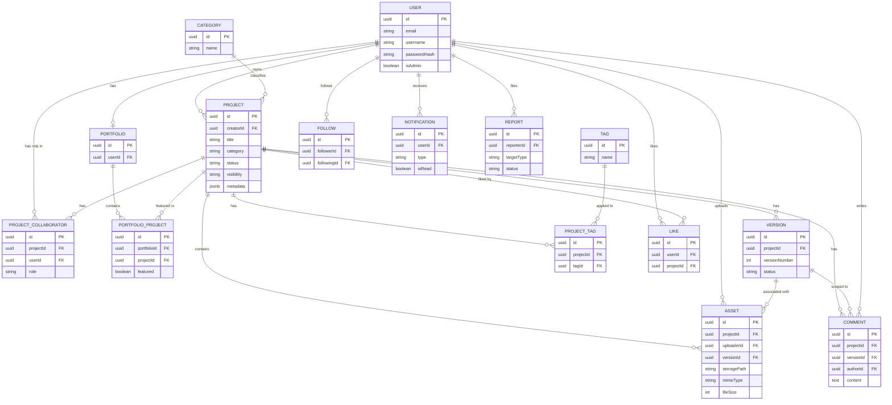

# CreativeSpace
## Technical Requirements Document (TRD)

| | |
|---|---|
| **Document Version** | 1.0 |
| **Date** | September 9, 2026 |
| **Project** | CreativeSpace — Unified Creator Ecosystem Platform |
| **Document Type** | Technical Requirements Document (TRD) |
| **Prepared For** | BSc CSIT Final Year Project |
| **Related Documents** | CreativeSpace BRD v1.0, CreativeSpace PRD v1.0 |
| **Status** | Draft for Academic Submission |

---

## Table of Contents

1. Technical Overview
2. Architecture
3. Technology Stack
4. System Components
5. Frontend Architecture
6. Backend Architecture
7. Database Architecture
8. Object Storage Architecture
9. CDN Architecture
10. Upload Architecture
11. Authentication Architecture
12. Authorization Architecture
13. RBAC (Role-Based Access Control)
14. Database Schema
15. Entity Relationship Diagram (ERD)
16. API Architecture
17. API Endpoint List
18. Request/Response Examples
19. Validation
20. Error Handling
21. File Processing
22. Compression
23. Thumbnail Generation
24. Background Jobs
25. Caching
26. Search Architecture
27. Recommendation Architecture
28. Collaboration Architecture
29. Versioning Architecture
30. Notification Architecture
31. Security Architecture
32. Privacy
33. Scalability
34. Performance
35. Logging
36. Monitoring
37. Backup
38. Disaster Recovery
39. Deployment Architecture
40. Environment Variables / Configuration
41. CI/CD Considerations
42. Testing Strategy
43. Unit Testing
44. Integration Testing
45. End-to-End Testing
46. Load Testing
47. Security Testing
48. Development Phases
49. Technical Risks
50. Technical Assumptions
51. Technical Constraints
52. Future Architecture Improvements

**Appendices:** A. Requirements Traceability Matrix · B. System Module List · C. MVP Feature List · D. Future Feature List · E. Recommended Development Roadmap

---

## 1. Technical Overview

This TRD specifies **how** CreativeSpace will be built to satisfy the Product Requirements (PRD) and, transitively, the Business Requirements (BRD). It defines the system architecture, technology stack, data model, API design, security model, and operational concerns (scalability, deployment, testing). Each technical decision is scoped for a BSc CSIT student team to realistically implement, while remaining consistent with production-grade practices so the design demonstrates genuine software engineering competency.

Where a technical decision is not fully finalized, it is explicitly marked **"To Be Decided (TBD)"** with recommended alternatives and a stated recommendation, per the project's documentation requirements.

---

## 2. Architecture

### 2.1 High-Level System Architecture

```
                         ┌─────────────────────────┐
                         │        Client            │
                         │  (Browser - Next.js SPA/ │
                         │   SSR pages, React UI)   │
                         └────────────┬─────────────┘
                                      │ HTTPS
                                      ▼
                         ┌─────────────────────────┐
                         │   Next.js Application    │
                         │  - Pages / App Router     │
                         │  - API Routes / Server    │
                         │    Actions                │
                         │  - Auth middleware         │
                         │  - Business logic layer   │
                         └────┬───────────────┬──────┘
                              │               │
                     Prisma ORM│               │ Signed URL issuance
                              ▼               ▼
                 ┌─────────────────────┐  ┌────────────────────────┐
                 │   PostgreSQL         │  │  Object Storage          │
                 │ (metadata, relational│  │ (Supabase Storage / R2 /  │
                 │  data)                │  │  S3 - actual files)      │
                 └─────────────────────┘  └──────────┬─────────────┘
                                                       │
                                                       ▼
                                            ┌────────────────────┐
                                            │        CDN           │
                                            │ (asset delivery,     │
                                            │  thumbnails)          │
                                            └────────────────────┘

        ┌────────────────────────┐        ┌───────────────────────┐
        │   Background Job Queue  │◄──────►│   Cache Layer (Redis)  │
        │ (thumbnails, recs,      │        │ (sessions, hot queries,│
        │  notifications)         │        │  recommendation cache) │
        └────────────────────────┘        └───────────────────────┘
```

### 2.2 Architectural Style

CreativeSpace uses a **monolithic, server-rendered Next.js application** (application + API layer combined) backed by **PostgreSQL** for relational metadata and a **separate Object Storage service** for binary media files, with a **CDN** in front of the storage layer for asset delivery. A lightweight **background job mechanism** handles asynchronous work (thumbnail generation, recommendation recalculation, notification dispatch).

This monolithic-with-clear-module-boundaries approach (rather than microservices) is deliberately chosen: it is realistic for a small student team to build, test, and deploy within an academic timeline, while the module boundaries defined in the PRD (Section 12) keep the codebase organized enough to evolve toward service separation later if needed (see Section 52, Future Architecture Improvements).

---

## 3. Technology Stack

| Layer | Technology | Justification |
|---|---|---|
| Frontend Framework | Next.js (React, TypeScript) | Combines SSR/SSG and client interactivity in one framework; strong ecosystem; matches project's stated preference |
| Styling | Tailwind CSS | Rapid, consistent UI development without a heavy custom CSS layer |
| Backend/API | Next.js API Routes / Server Actions | Avoids standing up a separate backend service; colocates frontend and backend for a small team |
| Database | PostgreSQL | Mature, relational, strong support for structured + JSON (JSONB) data — needed for the hybrid metadata model (Section 7) |
| ORM | Prisma | Type-safe database access, migrations, good fit with TypeScript/Next.js |
| Object Storage | Supabase Storage (MVP) — see Section 8 for full comparison | Free/low-cost tier suitable for student budgets, S3-compatible semantics, integrates with signed URLs |
| Authentication | NextAuth.js (Auth.js) — **recommended**, alternatives: Supabase Auth, Clerk | Mature Next.js integration, supports credentials + OAuth, session/JWT handling out of the box |
| Caching / Queue | Redis (e.g., Upstash Redis free tier) | Lightweight caching and simple job queue support suitable for MVP scale |
| Deployment | Vercel (application) + managed PostgreSQL (e.g., Supabase/Neon) | Free/low-cost tiers, native Next.js support, minimal DevOps overhead for a student team |

### 3.1 Authentication Provider — Decision

| Option | Pros | Cons |
|---|---|---|
| **NextAuth.js / Auth.js** (Recommended) | Free, self-hosted, first-class Next.js support, flexible providers (credentials + OAuth) | Requires slightly more manual setup than a managed auth SaaS |
| Supabase Auth | Bundled if already using Supabase Storage/DB | Adds coupling to Supabase ecosystem |
| Clerk | Very fast to integrate, good UI components | Paid beyond free tier limits at scale; another external dependency |

**Recommendation:** NextAuth.js (Auth.js) with credentials-based auth for MVP, with the option to add OAuth providers (Google) later at low incremental cost.

### 3.2 Deployment Architecture — Decision

| Option | Pros | Cons |
|---|---|---|
| **Vercel** (Recommended for MVP) | Native Next.js support, zero-config CI deploy, generous free tier | Serverless function limits for very large uploads (mitigated by direct-to-storage upload architecture, Section 10) |
| Self-hosted VPS (e.g., a single Linux server) | Full control, no vendor limits | Requires manual DevOps (nginx, process management, TLS) — higher burden for a student team |

**Recommendation:** Vercel for the Next.js application; managed PostgreSQL (Supabase or Neon) for the database; Supabase Storage (or chosen alternative) for object storage.

---
## 4. System Components

| Component | Responsibility |
|---|---|
| Next.js Frontend | Renders UI, handles client-side interactivity, calls API routes |
| Next.js API Layer | Business logic, validation, authorization checks, ORM access |
| PostgreSQL | Stores all relational/structured data (users, projects, metadata, roles, comments, versions) |
| Object Storage | Stores binary asset files (images, audio, video, documents) |
| CDN | Serves object storage content with low latency and caching |
| Redis Cache/Queue | Session storage, hot-query caching, lightweight background job queue |
| Background Worker | Executes async jobs: thumbnail generation, recommendation recalculation, notification dispatch |

---

## 5. Frontend Architecture

- Built with **Next.js App Router**, using a mix of Server Components (for data-heavy, SEO-relevant pages like Portfolio/Discovery) and Client Components (for interactive elements like upload forms, comment threads).
- **Route structure** mirrors the module breakdown from the PRD:
  - `/` — landing/discovery
  - `/login`, `/register` — auth
  - `/profile/[username]` — public profile/portfolio
  - `/dashboard` — creator's own projects
  - `/projects/[id]` — project workspace (assets, versions, comments, collaborators)
  - `/discover` — search/browse
  - `/admin/*` — admin module (route-protected)
- **State management:** Local component state + React Server Component data fetching for most views; a lightweight client state library (e.g., React Context or Zustand) only where cross-component client state is genuinely needed (e.g., upload progress).
- **Styling:** Tailwind CSS utility classes; a small shared component library (buttons, cards, modals, form inputs) to keep the UI consistent across modules.

---

## 6. Backend Architecture

- Backend logic lives in **Next.js API Routes / Server Actions**, organized by module (`/api/auth`, `/api/projects`, `/api/assets`, `/api/collaborators`, `/api/comments`, `/api/versions`, `/api/portfolio`, `/api/discover`, `/api/recommendations`, `/api/admin`).
- A **service layer** sits between API route handlers and Prisma queries, so business logic (permission checks, validation) is not duplicated across routes and is unit-testable independent of HTTP.
- **Layered structure per request:**

```
Request -> Auth Middleware -> Route Handler -> Validation -> Authorization Check
   -> Service Layer (business logic) -> Prisma (data access) -> PostgreSQL
   -> Response
```

- All mutating routes (POST/PATCH/DELETE) perform: (1) authentication check, (2) input validation, (3) authorization/role check scoped to the specific resource, (4) the operation, (5) an audit log entry where relevant (see Section 31).

---
## 7. Database Architecture

### 7.1 Creator-Specific Metadata: Approach Analysis

The BRD/PRD require a common Project model that also supports discipline-specific fields (Photography, Music, Writing, Animation, Art, Video, UI/UX metadata). Three approaches were analyzed:

| Approach | Description | Advantages | Disadvantages |
|---|---|---|---|
| **1. Separate metadata tables** (one table per discipline, e.g. `PhotographyMetadata`, `MusicMetadata`) | Each discipline gets its own strongly-typed table with a foreign key to `Project` | Strong typing, easy to query/index specific fields, clear schema | Adding a new discipline requires a migration; many small tables; more JOINs |
| **2. JSON metadata** (single `metadata` JSONB column on `Project`) | All discipline-specific fields stored as a flexible JSON blob | No migration needed to add new fields/disciplines; simple schema | Weaker typing/validation at the DB level; harder to index/query individual fields efficiently at scale |
| **3. Hybrid approach (Recommended)** | Common fields as real columns on `Project`; a `category` enum/string field; discipline-specific fields stored in a `metadata JSONB` column, validated at the application layer (e.g., using a schema validation library keyed by category) | Combines schema stability for common fields with flexibility for discipline-specific fields; new disciplines can be added without a DB migration; PostgreSQL JSONB supports indexing (GIN indexes) if specific fields need to be queried | Requires disciplined application-layer validation to avoid inconsistent metadata shapes |

**Recommendation: Approach 3 (Hybrid).** It matches the project's requirement to support many creator types without a schema rebuild per type, while PostgreSQL's native JSONB support (including optional GIN indexing on specific keys) keeps query performance acceptable at MVP and near-term scale. Application-layer validation (e.g., a Zod/TypeScript schema per category) enforces structure without requiring a database migration for every new discipline.

### 7.2 Database Technology

**PostgreSQL** is used for all relational/structured data. It is not used to store binary media files (see Section 8). Prisma ORM provides type-safe schema definition, migrations, and query access from the Next.js application.

---

## 8. Object Storage Architecture

### 8.1 Why Not Store Media in PostgreSQL

Storing large binary files (images, audio, video) directly in PostgreSQL is avoided because: (a) it bloats the database and degrades backup/restore performance, (b) it is significantly more expensive per GB than dedicated object storage, (c) it does not benefit from CDN edge caching, and (d) connection-pooled relational databases are not designed for high-throughput binary streaming.

### 8.2 Object Storage Provider Comparison

| Provider | Pros | Cons | Fit |
|---|---|---|---|
| **Supabase Storage** | Generous free tier, integrates directly with Supabase Postgres/Auth if used, S3-compatible API, signed URL support | Smaller ecosystem than AWS; regional availability more limited | **Recommended for MVP/student implementation** |
| Cloudflare R2 | No egress fees (major cost advantage at scale), S3-compatible | Slightly more setup for a small team, separate account/billing from DB provider | Strong candidate for future scale-up |
| Cloudinary | Excellent built-in image/video transformation (thumbnails, compression) out of the box | More expensive at scale for pure storage; opinionated media pipeline | Good for MVP if heavy image transformation is prioritized over storage cost |
| Amazon S3 | Industry standard, extremely scalable, deep ecosystem | Egress costs, more complex IAM setup — steeper learning curve for a student team | Strong candidate for future production scale |

**Recommendation:**
- **MVP/Student Implementation:** Supabase Storage — lowest setup friction, generous free tier, native signed URL support, pairs naturally with a Supabase-hosted PostgreSQL instance.
- **Future Scalability:** Migrate to Cloudflare R2 (for egress-cost efficiency) or AWS S3 (for ecosystem maturity) once usage/cost justifies migration. The storage access layer should be abstracted behind a service interface (Section 8.3) to make this migration low-risk.

### 8.3 Storage Abstraction Layer

The application will not call the storage provider's SDK directly from route handlers. Instead, a thin internal `StorageService` interface (e.g., `generateUploadUrl()`, `getSignedDownloadUrl()`, `deleteObject()`) wraps the provider SDK, so switching providers later requires changing one module, not every call site.

### 8.4 What PostgreSQL Stores vs. What Object Storage Stores

| PostgreSQL (`Asset` table) | Object Storage |
|---|---|
| Asset ID, Project ID, Creator ID | Actual file bytes |
| File name, MIME type, file size | — |
| Storage path/key, version reference | — |
| Created date | — |

---

## 9. CDN Architecture

A CDN sits in front of the object storage bucket to serve assets (especially images/thumbnails and portfolio media) with low latency and reduced repeated load on the storage origin.

- **MVP:** Supabase Storage's built-in CDN-backed public URLs (for Public-visibility assets) are used directly; Cloudflare can optionally be layered in front for additional caching if needed.
- **Private assets** are never served through a public CDN URL — they are served via short-lived **signed URLs** (Section 10, Section 31) that bypass long-term caching or use provider-supported private/authenticated CDN delivery.
- **Future:** A dedicated CDN (e.g., Cloudflare) with cache-control headers tuned per asset visibility and explicit cache invalidation on asset deletion/replacement.

---

## 10. Upload Architecture

### 10.1 Direct Upload Flow

Large media files must not pass through the Next.js application server unnecessarily (this would consume server memory/bandwidth and hit serverless function payload/time limits on platforms like Vercel). CreativeSpace uses a **direct-to-storage upload architecture** using signed URLs:

```
1. User selects a file to upload in the browser
2. Browser calls POST /api/assets/upload-url
       -> Server authenticates the user
       -> Server checks the user has upload permission on the target Project
          (role check + storage quota check)
       -> Server requests a short-lived SIGNED UPLOAD URL from the
          Object Storage provider (not the file itself)
       -> Server returns the signed URL + a generated storage path/key to the browser
3. Browser uploads the file DIRECTLY to Object Storage using the signed URL
       (file bytes never pass through the Next.js server)
4. Browser notifies the server upon completion: POST /api/assets
       -> Server verifies the object now exists at the expected path
          (and optionally its size/MIME type)
       -> Server writes Asset metadata (path, size, MIME type, projectId,
          uploaderId, version) into PostgreSQL
5. A background job may generate a thumbnail/preview asynchronously (Section 23/24)
```

### 10.2 Why This Matters

This architecture keeps the application server stateless and lightweight for uploads — it only issues short-lived signed URLs and records metadata, never buffers or streams the file itself. This directly supports NFR-04 (large uploads must not block/crash the application server) and keeps the system compatible with serverless deployment (Vercel function execution/payload limits).

---
## 11. Authentication Architecture

- Implemented via **NextAuth.js (Auth.js)** using a Credentials provider (email + hashed password) for MVP, with room to add OAuth providers later.
- Passwords hashed using **bcrypt/argon2** (never stored in plaintext) — satisfies NFR-01.
- Sessions managed via signed, HTTP-only session cookies (or JWT, depending on NextAuth configuration), preventing client-side script access to session tokens.
- Password reset via a time-limited, single-use email token flow.
- Login attempts rate-limited (e.g., via middleware or a Redis-backed counter) to reduce brute-force risk (AUTH-5).

```
Login Flow:
User submits email+password -> Server verifies hash match against stored hash
   -> On success: create session (cookie/JWT) -> respond authenticated
   -> On failure: increment rate-limit counter -> respond generic error
      (no "email exists" vs "wrong password" disclosure)
```

## 12. Authorization Architecture

Authorization is enforced **per-resource, per-action**, not merely by checking that a user is logged in. Every mutating or sensitive-read API route performs an explicit check: *"Does this authenticated user have the required role/relationship to this specific Project/Asset?"*

**Why checking only `projectId` is not enough:** If an API route only validates that a `projectId` exists and that the requester is authenticated — without checking the requester's actual relationship to that project (Owner / Collaborator / Reviewer / none) — any authenticated user could access or modify **any** project by simply supplying its ID. This is a classic **Insecure Direct Object Reference (IDOR)** vulnerability. CreativeSpace's authorization layer therefore always resolves: `(userId, projectId) -> role`, and denies the action if no role grants the required permission — this check happens on the server for every request, never trusted from client-supplied role/permission claims.

## 13. RBAC (Role-Based Access Control)

| Role | Scope | Key Permissions (see PRD Section 18 for full matrix) |
|---|---|---|
| Owner | Per-project | Full control: edit, delete, invite/remove collaborators, publish |
| Collaborator | Per-project | Upload/edit assets within permitted scope, comment |
| Client/Reviewer | Per-project | View, comment, approve/reject — no edit/delete |
| Admin | Platform-wide | Moderate content/users, manage categories, view stats |

RBAC is implemented via a `ProjectCollaborator` join table (userId, projectId, role) checked on every project-scoped request, plus a platform-level `isAdmin` flag on `User` for admin-only routes. A shared `authorize(user, project, action)` utility function centralizes this logic so permission rules are defined once and reused across all API routes (avoiding inconsistent, duplicated checks).

---

## 14. Database Schema

The schema below reflects the hybrid metadata approach (Section 7.1). Only MVP-relevant entities are detailed in full; future entities (Service, DigitalProduct, Order, Review, Payment) are listed at a summary level.

### 14.1 `User`
| Field | Type | Notes |
|---|---|---|
| id | UUID (PK) | |
| email | string, unique | |
| passwordHash | string | nullable if OAuth-only |
| username | string, unique | used in public profile URL |
| displayName | string | |
| bio | text, nullable | |
| avatarUrl | string, nullable | |
| isAdmin | boolean, default false | |
| createdAt / updatedAt | timestamp | |

**Indexes:** unique on `email`, unique on `username`.

### 14.2 `Profile` (optional extension of User, or merged into User for MVP simplicity)
| Field | Type | Notes |
|---|---|---|
| id | UUID (PK) | |
| userId | UUID (FK -> User, unique) | 1:1 with User |
| disciplines | string[] / JSONB | e.g. ["Illustration","Photography"] |
| socialLinks | JSONB, nullable | future-friendly, optional |

*Recommendation: for MVP simplicity, Profile fields may be merged directly into `User` rather than a separate table, since it is strictly 1:1. Kept separate here for documentation clarity and to allow future expansion without touching the core `User` table.*

### 14.3 `Project`
| Field | Type | Notes |
|---|---|---|
| id | UUID (PK) | |
| creatorId | UUID (FK -> User) | the Owner |
| title | string | |
| description | text | |
| category | enum/string | e.g. Photography, Music, Writing, Animation, Art, Video, UIUX |
| status | enum | Idea, InProgress, InReview, Completed |
| visibility | enum | Private, CollaboratorsOnly, Public |
| metadata | JSONB | discipline-specific fields, validated at application layer |
| createdAt / updatedAt | timestamp | |

**Indexes:** index on `creatorId`, index on `category`, index on `visibility` (for Discovery queries), optional GIN index on `metadata` if specific keys need querying.
**FK:** `creatorId` -> `User.id` (cascade behavior: restrict/soft-handle per BUS-R6 — do not silently cascade-delete referenced portfolio content).

### 14.4 `ProjectCollaborator`
| Field | Type | Notes |
|---|---|---|
| id | UUID (PK) | |
| projectId | UUID (FK -> Project) | |
| userId | UUID (FK -> User) | |
| role | enum | Owner, Collaborator, ClientReviewer |
| invitedAt / acceptedAt | timestamp | |

**Indexes:** composite unique on (`projectId`, `userId`); index on `userId` (to list "my projects across roles").
**Cardinality:** Project 1—N ProjectCollaborator N—1 User (many-to-many between Project and User via this join table).

### 14.5 `Asset`
| Field | Type | Notes |
|---|---|---|
| id | UUID (PK) | |
| projectId | UUID (FK -> Project) | |
| uploaderId | UUID (FK -> User) | |
| versionId | UUID (FK -> Version), nullable | |
| fileName | string | |
| mimeType | string | |
| fileSize | integer (bytes) | |
| storagePath | string | key/path in object storage |
| createdAt | timestamp | |

**Indexes:** index on `projectId`, index on `versionId`.

### 14.6 `Version`
| Field | Type | Notes |
|---|---|---|
| id | UUID (PK) | |
| projectId | UUID (FK -> Project) | |
| versionNumber | integer | sequential per project |
| createdById | UUID (FK -> User) | |
| status | enum | Draft, Approved, Rejected |
| createdAt | timestamp | |

**Indexes:** composite unique on (`projectId`, `versionNumber`).

### 14.7 `Comment`
| Field | Type | Notes |
|---|---|---|
| id | UUID (PK) | |
| projectId | UUID (FK -> Project) | |
| versionId | UUID (FK -> Version), nullable | |
| authorId | UUID (FK -> User) | |
| content | text | |
| createdAt | timestamp | |

**Indexes:** index on `projectId`, index on `versionId`.

### 14.8 `Portfolio`
| Field | Type | Notes |
|---|---|---|
| id | UUID (PK) | |
| userId | UUID (FK -> User, unique) | 1:1 — one portfolio per user |
| customSlug | string, nullable | future scope |

### 14.9 `PortfolioProject`
| Field | Type | Notes |
|---|---|---|
| id | UUID (PK) | |
| portfolioId | UUID (FK -> Portfolio) | |
| projectId | UUID (FK -> Project) | |
| featured | boolean, default false | |
| displayOrder | integer | |

**Indexes:** composite unique on (`portfolioId`, `projectId`).

### 14.10 `Follow`
| Field | Type | Notes |
|---|---|---|
| id | UUID (PK) | |
| followerId | UUID (FK -> User) | |
| followingId | UUID (FK -> User) | |

**Indexes:** composite unique on (`followerId`, `followingId`).

### 14.11 `Like`
| Field | Type | Notes |
|---|---|---|
| id | UUID (PK) | |
| userId | UUID (FK -> User) | |
| projectId | UUID (FK -> Project) | |

**Indexes:** composite unique on (`userId`, `projectId`) — supports popularity ranking (Section 27).

### 14.12 `Tag` / `ProjectTag`
| Table | Key Fields |
|---|---|
| `Tag` | id (PK), name (unique) |
| `ProjectTag` | id (PK), projectId (FK), tagId (FK) — composite unique (projectId, tagId) |

### 14.13 `Category`
| Field | Type | Notes |
|---|---|---|
| id | UUID (PK) | |
| name | string, unique | admin-managed (ADM-3) |

### 14.14 `Notification`
| Field | Type | Notes |
|---|---|---|
| id | UUID (PK) | |
| userId | UUID (FK -> User) | recipient |
| type | enum | Invitation, Comment, Approval, Rejection, etc. |
| relatedProjectId | UUID (FK -> Project), nullable | |
| isRead | boolean, default false | |
| createdAt | timestamp | |

**Indexes:** index on (`userId`, `isRead`).

### 14.15 `Report`
| Field | Type | Notes |
|---|---|---|
| id | UUID (PK) | |
| reporterId | UUID (FK -> User) | |
| targetType | enum | Project, User, Comment |
| targetId | UUID | polymorphic reference |
| reason | text | |
| status | enum | Open, Resolved, Dismissed |
| createdAt | timestamp | |

### 14.16 Future Entities (Summary Only)

| Entity | Purpose |
|---|---|
| `Service` | A listed creative service offered by a creator (future marketplace) |
| `DigitalProduct` | A listed digital product (template, preset, etc.) |
| `Order` | A purchase of a Service or DigitalProduct |
| `Review` | Buyer review of a completed Order |
| `Payment` | Payment record associated with an Order, including platform fee |

These are deliberately left at summary level — full schema design is deferred to the marketplace's future implementation phase, consistent with BRD/PRD future-scope boundaries.

---
## 15. Entity Relationship Diagram (ERD)



---

## 16. API Architecture

The API follows **REST conventions** over Next.js API Routes, returning JSON. All routes require authentication except public read endpoints explicitly marked otherwise (e.g., public portfolio view, public discovery/search). All mutating routes apply the Authorization check described in Section 12 before executing.

**Standard response envelope:**
```json
{
  "success": true,
  "data": { },
  "error": null
}
```
On failure:
```json
{
  "success": false,
  "data": null,
  "error": { "code": "FORBIDDEN", "message": "You do not have permission to edit this project." }
}
```

---

## 17. API Endpoint List

### Authentication
| Method | Endpoint | Auth Required | Description |
|---|---|---|---|
| POST | /api/auth/register | No | Create a new user account |
| POST | /api/auth/login | No | Authenticate and create a session |
| POST | /api/auth/logout | Yes | End the current session |
| POST | /api/auth/password-reset | No | Request/complete password reset |

### Projects
| Method | Endpoint | Auth Required | Description |
|---|---|---|---|
| GET | /api/projects | Yes | List current user's accessible projects |
| POST | /api/projects | Yes | Create a new project |
| GET | /api/projects/:id | Conditional | Get project details (visibility/role enforced) |
| PATCH | /api/projects/:id | Yes (Owner) | Update project fields |
| DELETE | /api/projects/:id | Yes (Owner) | Delete a project |

### Assets
| Method | Endpoint | Auth Required | Description |
|---|---|---|---|
| POST | /api/assets/upload-url | Yes | Request a signed upload URL (Section 10) |
| POST | /api/assets | Yes | Record asset metadata after direct upload completes |
| GET | /api/projects/:id/assets | Conditional | List assets for a project |
| DELETE | /api/assets/:id | Yes (permitted role) | Delete an asset |

### Collaboration
| Method | Endpoint | Auth Required | Description |
|---|---|---|---|
| POST | /api/projects/:id/collaborators | Yes (Owner) | Invite a collaborator/reviewer |
| PATCH | /api/projects/:id/collaborators/:userId | Yes (Owner) | Change a collaborator's role |
| DELETE | /api/projects/:id/collaborators/:userId | Yes (Owner) | Remove a collaborator |

### Comments
| Method | Endpoint | Auth Required | Description |
|---|---|---|---|
| POST | /api/projects/:id/comments | Yes (permitted role) | Add a comment |
| GET | /api/projects/:id/comments | Conditional | List comments for a project/version |

### Versions
| Method | Endpoint | Auth Required | Description |
|---|---|---|---|
| POST | /api/projects/:id/versions | Yes (Owner/Collaborator) | Create a new version |
| GET | /api/projects/:id/versions | Conditional | List versions |
| PATCH | /api/projects/:id/versions/:versionId | Yes (Owner/Reviewer) | Approve/reject a version |

### Portfolio
| Method | Endpoint | Auth Required | Description |
|---|---|---|---|
| GET | /api/portfolio/:username | No | View a public portfolio |
| POST | /api/portfolio/projects | Yes | Add a completed project to portfolio |
| DELETE | /api/portfolio/projects/:id | Yes | Remove a project from portfolio |

### Discovery
| Method | Endpoint | Auth Required | Description |
|---|---|---|---|
| GET | /api/discover | No | Browse trending/popular content |
| GET | /api/search | No | Keyword/category/tag search |

### Recommendations
| Method | Endpoint | Auth Required | Description |
|---|---|---|---|
| GET | /api/recommendations | Yes | Get personalized recommendations |

### Admin
| Method | Endpoint | Auth Required | Description |
|---|---|---|---|
| GET | /api/admin/reports | Yes (Admin) | List content/user reports |
| PATCH | /api/admin/reports/:id | Yes (Admin) | Resolve a report |
| GET/POST | /api/admin/categories | Yes (Admin) | Manage categories |
| GET | /api/admin/stats | Yes (Admin) | Platform statistics |

---

## 18. Request/Response Examples

**Create Project — `POST /api/projects`**
```json
// Request
{
  "title": "Client X Logo Set",
  "description": "Brand identity illustration set",
  "category": "Illustration",
  "visibility": "Private",
  "metadata": {
    "software": "Procreate",
    "style": "Flat/Vector",
    "canvasWidth": 4000,
    "canvasHeight": 4000
  }
}

// Response (201)
{
  "success": true,
  "data": {
    "id": "b3f1...",
    "title": "Client X Logo Set",
    "status": "Idea",
    "visibility": "Private",
    "createdAt": "2026-09-09T10:00:00Z"
  },
  "error": null
}
```

**Request Upload URL — `POST /api/assets/upload-url`**
```json
// Request
{ "projectId": "b3f1...", "fileName": "sketch_v1.png", "mimeType": "image/png", "fileSize": 2400000 }

// Response (200)
{
  "success": true,
  "data": {
    "uploadUrl": "https://storage.example.com/signed-upload/...",
    "storagePath": "projects/b3f1.../sketch_v1_9f2a.png",
    "expiresIn": 300
  },
  "error": null
}
```

**Forbidden Action Example**
```json
// PATCH /api/projects/:id by a non-Owner Collaborator
{
  "success": false,
  "data": null,
  "error": { "code": "FORBIDDEN", "message": "Only the project owner can update project settings." }
}
```

---
## 19. Validation

- All request bodies validated using a schema validation library (e.g., **Zod**) at the API boundary before touching business logic or the database.
- Project `metadata` JSONB content validated against a **per-category schema** (e.g., a Zod schema selected by `category`) so discipline-specific fields remain structurally consistent despite being stored as JSON.
- File uploads validated for: MIME type allow-list, maximum file size, and (where feasible) file signature/magic-byte verification rather than trusting the client-declared MIME type alone (see Section 31.5).

## 20. Error Handling

- Centralized error-handling middleware/utility maps known error types (ValidationError, ForbiddenError, NotFoundError, ConflictError) to consistent HTTP status codes and the standard response envelope (Section 16).
- Unexpected/unhandled errors are logged server-side (Section 35) and returned to the client as a generic `500 Internal Server Error` without leaking stack traces or internal details.
- Client-side, all major views implement the error/empty/loading states defined in PRD Section 31.

## 21. File Processing

Uploaded assets may require post-upload processing (thumbnail generation, format normalization). This processing happens **asynchronously**, after the direct upload completes and metadata is recorded, via a background job (Section 24) — not inline in the upload request — so the upload response remains fast.

## 22. Compression

- Images: a background job generates a compressed, web-optimized version (e.g., WebP) alongside the original for use in listing/thumbnail contexts, while the original remains available for download.
- Video/audio: compression/transcoding is treated as **future scope** (Section 52) given the added infrastructure complexity (transcoding pipelines) relative to MVP timeline constraints; MVP stores and serves uploaded video/audio as-is, subject to file size limits.

## 23. Thumbnail Generation

```
Asset uploaded (image) -> metadata recorded -> background job triggered
   -> job downloads/reads the object from storage
   -> generates a resized thumbnail (e.g., 400px wide)
   -> uploads thumbnail back to Object Storage
   -> updates Asset record with thumbnailPath
```
For non-image types (audio/video/documents), a static type-appropriate icon/placeholder is used in MVP rather than generated previews (waveform/video-frame previews are future scope).

## 24. Background Jobs

- MVP uses a lightweight job mechanism (e.g., a Redis-backed queue such as BullMQ, or scheduled serverless functions) to run: thumbnail generation, recommendation recalculation (Section 27), and notification dispatch (Section 30).
- Jobs are idempotent where possible (safe to retry) and logged on failure for later investigation.
- **TBD:** exact queue technology — recommended default is a Redis-backed queue given Redis is already part of the stack for caching; alternative is provider-native scheduled/cron functions if queue infrastructure proves too heavy for MVP scope.

## 25. Caching

| Cached Item | Cache Layer | Invalidation Trigger |
|---|---|---|
| User session | Redis / signed cookie | Logout, expiry |
| Discovery/trending results | Redis, short TTL (e.g., 5–15 min) | TTL expiry; manual admin refresh |
| Recommendation results | Redis / precomputed table, longer TTL (batch-refreshed) | Scheduled batch job (Section 27) |
| Public portfolio pages | HTTP/CDN cache with short TTL | New project published, revalidation on update |

## 26. Search Architecture

- **MVP:** PostgreSQL full-text search (`tsvector`/`tsquery`) over `Project.title`, `Project.description`, and associated `Tag` names — sufficient for MVP scale and avoids introducing a separate search infrastructure (e.g., Elasticsearch) for a student project.
- Category and tag filters implemented as standard indexed `WHERE` clauses.
- **Future:** dedicated search service (e.g., Elasticsearch/Algolia/Meilisearch) if search volume/complexity (fuzzy matching, ranking sophistication) exceeds what PostgreSQL full-text search comfortably supports.

## 27. Recommendation Architecture

**Approach: Content-Based Filtering (MVP), with popularity blending.**

- **Inputs:** project `category`, `tags`, and (where available) the requesting user's interaction history (views, likes, follows, saves, past searches).
- **Similarity calculation:** projects are represented as feature vectors (e.g., one-hot/TF-IDF over category + tags); **cosine similarity** between a user's aggregated interaction vector and candidate project vectors ranks candidates by relevance.
- **Popularity blending:** raw content-similarity score combined with a popularity signal (recent likes/views) using a weighted sum, so recommendations are not purely niche.
- **Cold-start handling (REC-3):** users with no interaction history receive popularity/category-based recommendations (e.g., trending-in-category) until sufficient interaction data exists.
- **Efficiency (REC-4):** recommendations are **not recalculated on every request**. Instead, a scheduled background job periodically (e.g., hourly or daily, depending on load) recomputes and caches each active user's top-N recommendations; requests read from this precomputed cache. This avoids expensive similarity computation on the request path and keeps response times low as the user base grows.
- **Future (REC-5):** hybrid recommendation incorporating collaborative filtering (similar users' behavior, e.g., matrix factorization or item-item collaborative filtering) once sufficient interaction volume exists to make it statistically meaningful.

```
Scheduled Job (e.g., every N hours):
  For each active user:
    -> gather interaction history (likes, views, follows)
    -> build user preference vector (category/tag weighted)
    -> compute cosine similarity against candidate project vectors
    -> blend with popularity score
    -> store top-N results in a Recommendation cache/table
Request time:
  GET /api/recommendations -> read precomputed top-N for the user (fast path)
```

## 28. Collaboration Architecture

Implemented via the `ProjectCollaborator` join table (Section 14.4) and the shared `authorize()` utility (Section 12/13). Invitations are created as pending `ProjectCollaborator` rows (`acceptedAt = null`) and trigger a Notification (Section 30); acceptance sets `acceptedAt`. All project-scoped API routes resolve the requester's role via this table before proceeding — this is the technical mechanism that satisfies BUS-R2/BUS-R3 (BRD) and the permission matrix (PRD Section 18).

## 29. Versioning Architecture

Each `Version` row belongs to a `Project` and increments `versionNumber` sequentially. Assets uploaded as part of a revision are associated with the relevant `Version` via `Asset.versionId`. Comments and approve/reject actions are scoped to a `Version` (via `Comment.versionId` and `Version.status`), giving a clear, queryable history: *"what was said and decided about Version 2, specifically."* This directly implements PR-010–PR-013.

## 30. Notification Architecture

- Notification rows are created synchronously at the point of the triggering event (invitation created, comment posted, version approved/rejected) within the same request/transaction as the triggering action, ensuring notifications are never silently lost due to a separate job failing.
- MVP delivers notifications **in-app only** (a `Notification` table read by the client); email delivery is future scope (NOT-3), to avoid taking on transactional email infrastructure within the MVP timeline.

---
## 31. Security Architecture

CreativeSpace's security model addresses each of the following layers:

### 31.1 Authentication
Covered in Section 11 — hashed passwords, secure sessions, rate-limited login.

### 31.2 Authorization / Object-Level Access Control
Covered in Section 12 — every project/asset-scoped action resolves `(userId, resourceId) -> role` server-side; **never** trusts a client-supplied role or assumes `projectId` alone implies access. This applies uniformly to Projects, Assets, Versions, and Comments.

### 31.3 Ownership & Project Membership
Ownership is a first-class, non-nullable relationship (`Project.creatorId`) enforced at the database and application layer (BUS-R1). Membership (`ProjectCollaborator`) is the sole mechanism granting non-owner access — there is no implicit access by other means (e.g., being "logged in" alone never grants access to a Private project).

### 31.4 Signed URLs
Both **upload** (Section 10) and **private-asset download** access use short-lived, single-purpose signed URLs generated server-side after an authorization check — never long-lived public links for private content.

### 31.5 File Upload Security

```
User -> Authentication -> Permission check -> Generate signed upload URL
   -> Object Storage -> Validation/processing -> Metadata in PostgreSQL
```

| Concern | Mitigation |
|---|---|
| MIME validation | Server validates declared MIME type against an allow-list before issuing an upload URL |
| Extension validation | File extension cross-checked against declared MIME type |
| File signature/content validation | Where feasible, magic-byte/signature check post-upload (background job) to catch MIME spoofing |
| Maximum file size | Enforced both client-side (UX) and server-side (authoritative) before issuing the signed URL |
| Storage quota | Per-user/per-project quota checked before issuing the signed upload URL |
| Rate limiting | Upload-URL requests rate-limited per user to prevent abuse |
| Malicious files | Virus/malware scanning is **future/optional** (Section 52) — flagged explicitly as not covered in MVP |
| Private buckets | Object storage buckets default to private; public access only for assets on Public-visibility projects |
| Access expiration | Signed URLs expire quickly (e.g., 5 minutes for uploads, short-lived for private downloads) |
| File naming/path strategy | Storage paths use generated IDs (not user-supplied file names) to prevent path traversal/collision |
| Backup | See Section 37 |
| Versioning | Object storage versioning (provider-native, if available) considered as a defense-in-depth backup, distinct from the application's `Version` entity |

### 31.6 API Security
Input validation (Section 19) on every route; parameterized queries via Prisma (prevents SQL injection by construction); rate limiting on sensitive endpoints (auth, upload-url); CSRF protection via framework defaults for cookie-based sessions.

### 31.7 Audit Logging
Admin actions and permission-denied events are logged with actor, action, target, and timestamp (NFR-10), supporting later investigation of misuse.

---

## 32. Privacy

- Visibility enforcement (Private / Collaborators-Only / Public) is the primary privacy control and is enforced identically across API responses, Discovery/search indexing, and direct asset access — a Private project must never leak through any of these three paths.
- Account deletion removes/anonymizes personal profile fields; associated content ownership handling (e.g., orphaned collaborative projects) is defined at implementation time, defaulting to retaining project data with an anonymized "deleted user" placeholder rather than cascading deletes that could destroy collaborators' shared work.
- No third-party data sharing beyond operationally required providers (object storage, email delivery if added).

---

## 33. Scalability

| User Scale | Expected Bottleneck | Mitigation |
|---|---|---|
| ~100 users | None significant | Default configuration sufficient |
| ~1,000 users | Discovery/search query load; N+1 query risk in project listings | Add indexes (already specified in Section 14); ensure Prisma queries use `include`/`select` deliberately to avoid N+1; enable basic Redis caching for Discovery |
| ~10,000 users | Database read load on Discovery/search/recommendations; object storage bandwidth | Read caching (Section 25) for Discovery/trending; move recommendation computation fully to scheduled batch jobs (already designed this way, Section 27); introduce CDN in front of assets if not already active |
| ~100,000 users | Application server concurrency; DB connection limits; storage egress cost | Horizontal scaling of the application tier (serverless auto-scales on Vercel, or multiple app instances behind a load balancer if self-hosted); Prisma connection pooling (e.g., PgBouncer); pagination enforced everywhere (already required, PERF-1); consider migrating object storage to a lower-egress-cost provider (e.g., R2); consider dedicated search service (Section 26) |

**Techniques belonging in MVP:** pagination, database indexing, direct-upload architecture, basic Redis caching, background jobs for recommendations/thumbnails, connection pooling via Prisma.

**Future scalability improvements:** horizontal application scaling/load balancing, dedicated search service, CDN cache tuning, database read replicas, queue-based media processing pipeline, rate limiting at the edge/CDN layer.

---

## 34. Performance

- Pagination enforced on all list endpoints (Projects, Assets, Discovery, Comments) — PERF-1.
- Thumbnails used in list/grid views instead of full-resolution assets — PERF-3.
- Direct-to-storage uploads keep the application server's request-handling time bounded regardless of file size — PERF-2.
- Database indexes defined per Section 14 on all frequently filtered/joined columns (`creatorId`, `category`, `visibility`, `projectId`, etc.).

---

## 35. Logging

- Structured application logs (request method/path, status code, latency, userId where authenticated) for observability.
- Security-relevant events logged separately/flagged: failed logins, permission-denied responses, admin actions (Section 31.7).
- Logs should avoid recording sensitive data (raw passwords, full session tokens, full file contents).

## 36. Monitoring

- **MVP:** platform-provided monitoring (e.g., Vercel's built-in analytics/logs, database provider's dashboard) is sufficient given team size and scale.
- **Future:** dedicated error tracking (e.g., Sentry) and uptime monitoring as usage grows beyond academic evaluation scale.

## 37. Backup

- Managed PostgreSQL provider's automated daily backups (standard feature of providers like Supabase/Neon) relied upon for MVP — no custom backup pipeline required initially.
- Object storage: provider-native redundancy relied upon for MVP; explicit versioning/backup policy considered future scope once asset volume grows.

## 38. Disaster Recovery

- **MVP:** Recovery relies on the managed database provider's point-in-time restore capability and redeployment of the (stateless) application from source control — acceptable given academic-project risk tolerance.
- **Future:** documented RTO/RPO targets, periodic restore testing, and multi-region considerations if the platform moves toward production use.

---

## 39. Deployment Architecture

```
Developer -> Git push -> GitHub repository
   -> Vercel CI build & deploy (application)
   -> Managed PostgreSQL (Supabase/Neon) - migrations applied via Prisma Migrate
   -> Object Storage (Supabase Storage) - configured buckets/policies
   -> Redis (Upstash) - caching/queue
```

- **Environments:** `development` (local), `preview` (per-PR Vercel preview deployments), `production` (main branch).
- Database migrations run via `prisma migrate deploy` as part of the deployment pipeline, not manually against production.

## 40. Environment Variables / Configuration

| Variable | Purpose |
|---|---|
| `DATABASE_URL` | PostgreSQL connection string |
| `NEXTAUTH_SECRET` / `AUTH_SECRET` | Session/JWT signing secret |
| `NEXTAUTH_URL` | Base app URL for auth callbacks |
| `STORAGE_PROVIDER_URL` / `STORAGE_PROVIDER_KEY` | Object storage credentials |
| `STORAGE_BUCKET_NAME` | Target bucket for assets |
| `REDIS_URL` | Cache/queue connection |
| `MAX_UPLOAD_SIZE_MB` | Enforced upload limit |
| `NODE_ENV` | Environment flag |

All secrets are stored in the deployment platform's environment variable configuration (never committed to source control).

## 41. CI/CD Considerations

- GitHub Actions (or Vercel's built-in CI) runs on every pull request: install dependencies, run linter, run unit/integration tests, run `prisma migrate diff`/validate schema.
- Vercel preview deployments provide an isolated environment per PR for manual verification before merge.
- Main-branch merges trigger production deployment with migrations applied automatically.

---

## 42. Testing Strategy

Testing is layered to match the architecture's boundaries: unit tests for the service layer, integration tests for API routes + database, and end-to-end tests for critical user journeys.

## 43. Unit Testing
- Focus: service-layer business logic (permission resolution, metadata validation, recommendation scoring functions) in isolation from HTTP/DB where feasible, using a test framework such as Jest/Vitest.
- Target: authorization logic (Section 12) and validation logic (Section 19) receive priority coverage given their security relevance.

## 44. Integration Testing
- Focus: API routes against a real (test) database instance — verifying that role checks, validation, and data persistence work together correctly (e.g., "a Collaborator cannot delete a project," "a Client/Reviewer cannot upload an asset").

## 45. End-to-End Testing
- Focus: critical user journeys from PRD Section 7 — project creation through to portfolio publication and discovery — using a browser automation tool (e.g., Playwright).

## 46. Load Testing
- **MVP:** lightweight, manual/scripted load testing (e.g., using a tool like k6) against key endpoints (Discovery, Project listing) to validate pagination/indexing hold up under simulated concurrent load representative of the MVP's target scale (Section 33).

## 47. Security Testing
- Manual verification of the authorization matrix (PRD Section 18) — attempting each denied action as each role to confirm it is rejected.
- Basic checks for common web vulnerabilities: SQL injection (mitigated by Prisma's parameterized queries), XSS (mitigated by React's default escaping + input sanitization), IDOR (mitigated by Section 12's per-resource authorization).

---
## 48. Development Phases

| Phase | Focus | Key Deliverables |
|---|---|---|
| Phase 1 | Foundation | Auth, User/Profile, database schema + migrations, base UI shell |
| Phase 2 | Core Project & Assets | Project CRUD + metadata, direct-upload architecture, Asset module |
| Phase 3 | Collaboration & Feedback | RBAC/ProjectCollaborator, Versioning, Comments, Approve/Reject |
| Phase 4 | Portfolio & Discovery | Portfolio module, Search, basic Discovery, Notifications |
| Phase 5 | Recommendations & Admin | Content-based recommendation batch job, Admin module (reports, categories) |
| Phase 6 | Hardening & Testing | Security review (Section 47), load testing (Section 46), bug fixing, documentation polish |

## 49. Technical Risks

| ID | Risk | Mitigation |
|---|---|---|
| TR-RISK-01 | Hybrid JSONB metadata approach implemented inconsistently across categories | Enforce per-category validation schemas centrally (Section 7.1/19); code review checklist |
| TR-RISK-02 | Direct-upload signed URL flow misconfigured, exposing write access to unauthorized users | Server-side permission + quota check strictly before signed URL issuance (Section 10); test explicitly (Section 47) |
| TR-RISK-03 | Authorization checks duplicated inconsistently across routes, creating gaps | Centralize via shared `authorize()` utility (Section 12/13); integration tests per role/action |
| TR-RISK-04 | Recommendation batch job becomes a performance bottleneck as user count grows | Design as async/scheduled from the start (Section 27); monitor job duration |
| TR-RISK-05 | Small team underestimates effort for RBAC + versioning + feedback combined | Sequence Phase 3 with adequate time buffer; treat as highest-complexity phase |

## 50. Technical Assumptions

| ID | Assumption |
|---|---|
| TA-01 | The team has working proficiency in TypeScript/React/Next.js or budgeted learning time for it. |
| TA-02 | Free/low-cost tiers of Vercel, a managed Postgres provider, Supabase Storage, and Upstash Redis are sufficient for MVP development and academic evaluation load. |
| TA-03 | PostgreSQL JSONB performance is adequate at MVP scale without requiring specialized document-database infrastructure. |
| TA-04 | A single-region deployment is acceptable for MVP (no multi-region requirement). |

## 51. Technical Constraints

| ID | Constraint |
|---|---|
| TC-01 | Must be deliverable within the academic project timeline (BRD C-01). |
| TC-02 | Must operate within free/low-cost infrastructure tiers (BRD C-02). |
| TC-03 | Serverless deployment (if Vercel is used) imposes function execution time/payload limits, reinforced by the direct-upload architecture (Section 10) as the mitigation. |
| TC-04 | Small team size limits the number of modules that can be built to production quality within the timeline — MVP scope (PRD Section 32) is deliberately bounded accordingly. |

## 52. Future Architecture Improvements

- Migrate object storage to Cloudflare R2 or AWS S3 as usage/cost patterns justify (Section 8.2).
- Introduce a dedicated search service (Elasticsearch/Meilisearch/Algolia) if PostgreSQL full-text search becomes a bottleneck (Section 26).
- Introduce collaborative-filtering signals into the recommendation system (hybrid model, Section 27).
- Add virus/malware scanning to the upload pipeline (Section 31.5).
- Add video/audio transcoding and timestamp/frame-specific feedback (PRD VER-4).
- Introduce read replicas and/or service decomposition (e.g., separating the Marketplace module into its own service) if the monolith becomes a scaling constraint.
- Add email notification delivery (PRD NOT-3) and, longer-term, real-time collaboration (WebSocket-based presence/live editing).
- Build out the full Marketplace module (Service, DigitalProduct, Order, Review, Payment entities) per BRD/PRD future scope.

---
## Appendix A — Requirements Traceability Matrix

The matrix below connects each Business Requirement (BRD) to its Product Requirement(s) (PRD) and the Technical Requirement/design section (TRD) that implements it, plus the owning system Module. TRD references use section numbers (e.g., "TRD §10") since technical decisions are documented as architecture sections rather than a flat TR-xxx list, given the number of interrelated design decisions per feature; the section number is the technical requirement's identifier for traceability purposes.

| Business Requirement (BRD) | Product Requirement (PRD) | Technical Requirement (TRD) | Module |
|---|---|---|---|
| BR-001 (creator profile) | PR-001, PR-002 | TRD §11 Authentication Architecture, §14.1 User Schema | Auth, Profile |
| BR-002 (common project structure) | PR-003 | TRD §7.1 Metadata Approach, §14.3 Project Schema | Project |
| BR-003 (discipline-specific metadata) | PR-004 | TRD §7.1 Hybrid JSONB Approach | Project |
| BR-004 (asset storage/organization) | PR-005 | TRD §8 Object Storage Architecture, §10 Upload Architecture | Asset |
| BR-005 (secure asset storage) | PR-006 | TRD §31.4–31.5 Signed URLs & Upload Security | Asset |
| BR-006 (multi-user collaboration) | PR-008, PR-009 | TRD §12 Authorization, §13 RBAC, §14.4 ProjectCollaborator, §28 Collaboration Architecture | Collaboration |
| BR-007 (draft versioning) | PR-010, PR-011 | TRD §14.6 Version Schema, §29 Versioning Architecture | Versioning |
| BR-008 (structured feedback) | PR-012, PR-013 | TRD §14.7 Comment Schema, §20 Error Handling, §29 | Feedback |
| BR-009 (portfolio publishing) | PR-014, PR-015, PR-016 | TRD §14.8–14.9 Portfolio Schema | Portfolio |
| BR-010 (discovery) | PR-017, PR-018, PR-019 | TRD §26 Search Architecture | Discovery |
| BR-011 (recommendations) | PR-020 | TRD §27 Recommendation Architecture | Recommendation |
| BR-012 (admin/moderation) | PR-023, PR-024, PR-025 | TRD §14.15 Report Schema, §31.7 Audit Logging | Admin |
| BR-013 (scalability) | (cross-cutting NFR) | TRD §33 Scalability, §34 Performance, §25 Caching | Platform-wide |
| BR-014 (future monetization) | PR-028 | TRD §52 Future Architecture Improvements | (Future) Monetization |
| BR-015 (future marketplace) | PR-026, PR-027 | TRD §14.16 Future Entities, §52 | (Future) Marketplace |
| BR-016 (visibility control) | PR-007 | TRD §14.3 visibility field, §31.2–31.3, §32 Privacy | Project |
| BR-017 (notifications) | PR-021 | TRD §14.14 Notification Schema, §30 Notification Architecture | Notification |
| BR-018 (abuse reporting) | PR-022, PR-023 | TRD §14.15 Report Schema | Admin |

---

## Appendix B — Overall System Module List

```
1. Auth Module
2. Profile Module
3. Project Module
4. Asset Module
5. Collaboration Module
6. Versioning Module
7. Feedback Module
8. Portfolio Module
9. Discovery Module
10. Recommendation Module
11. Notification Module
12. Admin Module
13. (Future) Marketplace Module
```

## Appendix C — MVP Feature List

- User registration, login, logout, password reset
- Creator profile creation/editing with discipline tags
- Project CRUD with common fields + hybrid JSONB discipline-specific metadata (≥3 disciplines at launch)
- Direct-to-storage asset upload with signed URLs, metadata recorded in PostgreSQL
- Project visibility control (Private / Collaborators-Only / Public)
- Role-based collaboration (Owner, Collaborator, Client/Reviewer) with enforced permissions
- Versioning (create/view version history)
- Comments and Approve/Reject feedback tied to versions
- Portfolio: select completed projects, public profile page
- Search and category/tag-based Discovery, basic trending
- Basic content-based recommendations (batch-computed)
- In-app notifications for key events
- Admin: content/user reports, category management

## Appendix D — Future Feature List

- Marketplace: Services, Digital Products, Orders, Payments, Reviews, Commission/Refund handling
- Subscription/premium tiers, additional storage purchases, promoted/featured listings
- Business/team/agency accounts
- Hybrid (content + collaborative filtering) recommendation system
- Timestamp/frame-specific feedback for video and audio
- Custom portfolio URLs/domains
- Advanced creator analytics
- Real-time collaborative editing
- Email notification channel
- Virus/malware scanning for uploads
- Video/audio transcoding and compression pipeline
- Migration to lower-egress-cost object storage (R2) or enterprise-grade storage (S3) at scale
- Dedicated search service, database read replicas, service decomposition

## Appendix E — Recommended Development Roadmap

```
Semester/Phase 1 (Foundation):
  Auth + Profile + DB schema/migrations + base UI shell

Semester/Phase 2 (Core Loop):
  Project CRUD + metadata + direct-upload asset architecture

Semester/Phase 3 (Collaboration Depth):
  RBAC + Collaborators + Versioning + Comments + Approve/Reject
  (highest-complexity phase — allocate the most time/buffer)

Semester/Phase 4 (Showcase & Discovery):
  Portfolio + Search/Discovery + Notifications

Semester/Phase 5 (Intelligence & Governance):
  Content-based Recommendations (batch job) + Admin module

Semester/Phase 6 (Hardening):
  Security review against the RBAC/permission matrix, load testing,
  bug fixing, final documentation and viva preparation

Post-Academic (Future Roadmap):
  Marketplace module -> Monetization -> Hybrid recommendations ->
  Advanced media processing -> Scale-driven infrastructure migrations
```

---

## Appendix — Document Control

| Field | Value |
|---|---|
| Related Documents | CreativeSpace BRD v1.0, CreativeSpace PRD v1.0 |
| Revision History | v1.0 — Initial draft, September 9, 2026 |

**— End of Technical Requirements Document —**
