# CreativeSpace BRD — Baseline Version 2.0 — Working Draft — Pending Final Stakeholder Approval
**Baseline Version:** 2.0 (Working Draft — Pending Final Stakeholder Approval)  
**Document Status:** Working Draft — Pending Final Stakeholder Approval (Not yet approved as authoritative)  
**Date:** November 2026  
**Author:** Senior Business Analyst & Product Documentation Specialist  
**Target File Location:** `docs/new_baseline/CreativeSpace_BRD.md`

---

## 1. Document Information

### 1.1 Document Overview
This Business Requirements Document (BRD) defines the proposed business foundation, operational scope, core workflows, business rules, and financial boundaries for **CreativeSpace**. It serves as the primary requirements baseline for stakeholder review, defining *what* the platform must achieve and *why*, without prescribing technical implementation details, database schemas, or software code.

### 1.2 Document Control & Revision History
| Version | Release Date | Author / Role | Status | Description of Changes |
| :--- | :--- | :--- | :--- | :--- |
| **1.0** | September 2026 | Legacy Architecture Team | Superseded (Historical) | Initial platform documentation; contained legacy connection-gating, commissions, and generalized networking. |
| **2.0-Draft** | November 2026 | Senior Business Analyst | Superseded | Comprehensive baseline revision: strict financial boundaries (Khalti platform promotion only; external user-to-user transactions), dual intake, scoped messaging, and landing page preservation. |
| **2.0-Draft-v2** | November 2026 | Senior Business Analyst | Superseded | Targeted corrections incorporating finalized stakeholder decisions: refined promotion rules, removed collaborator capacity caps, manual Project creation, alternative-time negotiation outcomes, selected booking hold, and 5-stage Idea lifecycle. |
| **2.0-Draft-v3** | November 2026 | Senior Business Analyst | Superseded | Consistency corrections applied across dual slot holds, selection release states, 48h reminders, admin inspection rules, marketplace lifecycle flow, and statutory wording. |
| **2.0-Draft-Final-Unified** | November 2026 | Senior Business Analyst & Product Documentation Specialist | Superseded | Complete unified document revision across both parts: added Section 8.1 Functional Module Catalog mapping modules 8.1-8.13 to Sections 9 & 16; fortified Section 9.3 attribution immutability; framed Project deletion contributor record retention as open decision DEC-021 alongside DEC-020; clarified promotion refund software exclusion as product scope without legal waiver; refined DEC-016 and DEC-018; converted all 12 Section 15 KPIs into structured operational specifications; and synchronized Glossary and Dependencies. |
| **2.0-Draft-Stakeholder-Reconciled** | November 2026 | Senior Business Analyst & Documentation Specialist | Working Draft (Pending Final Stakeholder Approval) | Complete reconciliation against Authoritative Stakeholder Decision Register v2.0 plus Final Targeted Consistency Correction Pass: (A) Removed Project messaging implication in Section 6 & A-004; (B) Corrected contributor version-publication wording in Section 10.2 Diagram 4 so Owner retains Project visibility control; (C) Separated approved booking queue/hold rules from open DEC-016 requester hold notice in Section 10.7; (D) Decoupled Marketplace Active/Inactive catalog availability control from fulfillment in Section 10.8 Diagram 10 & prose; (E) Scoped Project attribution preservation to active Project lifecycle and DEC-020 audit metadata while leaving post-deletion DEC-021 strictly OPEN; (F) Added 8.4 Project Versions, 8.8 cross-module principle, and full Admin moderation dependencies in Sections 8 & 16; (G) Clarified abuse reporting in read-only message archives (without reopening conversations); and (3.A-3.E) Refined KPI 9, KPI 10, KPI 11, Section 16 social link visibility, and DEC-017 superseded slot release consistency. |

### 1.3 Intended Audience
This document is targeted toward:
- **Platform Ownership & Executive Leadership:** To review and validate business objectives, financial model boundaries, operational scope, and finalized stakeholder decisions.
- **Product Management:** To guide the derivation of the subsequent Product Requirements Document (PRD) once this BRD is approved.
- **Technical Architecture & Engineering Leads:** To understand domain entities, business logic, state rules, and system boundaries prior to Technical Requirements Document (TRD) formulation.
- **Trust & Safety, Moderation, and Legal Reviewers:** To review platform operational boundaries, community standards, privacy constraints, and jurisdictional considerations.

### 1.4 Baseline Governance & Authority
This document represents a working draft incorporating finalized stakeholder review decisions. Historical documentation versions (v1.0 BRD, PRD, TRD) are retained strictly as historical archives and do not carry forward any authority. This document will become the sole authoritative baseline only upon formal stakeholder approval. Subsequent implementation audits and technical designs will be evaluated strictly against the approved version of this baseline and its derived PRD/TRD.

---

## 2. Executive Summary

**CreativeSpace** is a unified digital ecosystem purposefully engineered for creators, creative collaborators, service seekers, and art/design patrons. The platform bridges the fragmented lifecycle of creative endeavors by combining:
1. **A Professional Creative Portfolio & Showcase:** Enabling creators to present finalized works and iterative development stages across visual, audio, written, photographic, and multimedia disciplines.
2. **Community Showcase & Feed:** Fostering professional creative critique, discoverability, and peer interactions around creative work.
3. **Idea Collaboration Engine:** A focused hub where creators formulate creative concepts and assemble teams through independent owner invitations and creator applications across a structured 5-stage lifecycle.
4. **Structured Creator Service Booking:** A dedicated scheduling and negotiation framework enabling clients to request creator services while preserving creators' autonomy over commercial terms and calendar management.
5. **Completed Creative Product Marketplace:** A digital catalog allowing creators to list finished creative products directly to prospective buyers with private, data-minimized purchase inquiries.
6. **Platform Monetization via Paid Promotions:** An integrated promotion engine allowing creators to purchase package-defined visibility boosts settled directly to CreativeSpace via **Khalti** (without guaranteed reach, impressions, ranking, or engagement outcomes).
7. **Landing Page Aesthetic Preservation:** Uncompromising preservation of the established CreativeSpace landing page's visual identity, layout, typography, color palette, and artistic aesthetic as the brand benchmark.

### The Discovery & Operational Enablement Model
CreativeSpace operates on a **Discovery & Operational Enablement Model**. The platform maintains a strict separation between platform revenue and user-to-user commercial activities:
- **Platform Revenue:** Exclusively generated from paid promotional boosts paid by creators directly to CreativeSpace via the **Khalti** payment gateway (providing package-defined promotional placement opportunities with mandatory Sponsored labeling, without guaranteed placement or reach outcomes).
- **User-to-User Commercial Independence:** All commercial transactions concerning service bookings, Idea collaboration compensation, and completed product sales take place **directly between participants outside CreativeSpace**. CreativeSpace does not collect, process, verify, record, escrow, or refund user-to-user payments, nor does it manage physical or digital product fulfillment.
- **Workflow Independence:** Ideas and Projects are separate entities and workflows. Creating a Project based on an Idea is an independent, manual creator action without automated data copying or automated collaborator transfers.

By eliminating generalized social network distractions (such as friend requests, connection gating, and open direct messaging), CreativeSpace maintains an unwavering focus on creative industry productivity, portfolio integrity, and professional collaboration.

---

## 3. Business Background

The modern creator economy is characterized by fragmentation across disconnected digital tools:
- **Showcase Isolation:** Creators display finished artifacts on portfolio sites (e.g., Behance, ArtStation) but lack native mechanics to organize collaborative production teams or negotiate direct client bookings.
- **Social Media Noise:** Mainstream social platforms prioritize algorithmic virality and generic engagement over high-context creative critique, structured version histories, or professional commissioning.
- **Freelance Marketplace Friction:** Traditional freelance platforms impose heavy transaction commissions, strict communication lockdowns, and rigid escrow structures that alienate independent creators and informal collaborative squads.
- **Collaborative Chaos:** Ideation and creative co-production often dissolve across informal chat channels, resulting in untracked contributions, unclear agreements, and abandoned concepts.

CreativeSpace addresses this fragmentation by providing a cohesive digital venue where creative work can be showcased, iteratively developed with community feedback, matched with collaborative partners, and monetized via services and product sales—supported by a transparent, non-extractive business model.

---

## 4. Problem Statement

| Problem Area | Contemporary Challenge | CreativeSpace Business Solution |
| :--- | :--- | :--- |
| **Fragmented Creative Identity** | Creators must maintain disparate presences across portfolio hosts, social media, freelance directories, and direct messaging channels. | A single, unified profile that houses creative portfolios, community posts, active collaborative Ideas, service listings, and completed products. |
| **Extractive Platform Fees** | Traditional marketplaces deduct heavy transaction commissions from creators' service fees and product sales. | Elimination of platform fees on user-to-user transactions. Creators retain their full earnings through direct external settlement. |
| **Gated Professional Discovery** | Professional contact channels and social links are frequently hidden behind connection requests, friend approvals, or paywalls. | Fully public creator profiles and unobstructed public social media links for open external discovery. |
| **Unstructured Creative Ideation** | Concept collaboration on social media lacks governance, role definition, and tracking of interested applicants versus direct invitees. | A dedicated Idea Collaboration Engine featuring distinct, independent Owner Invitation and Creator Application workflows across a 5-stage lifecycle without arbitrary capacity caps. |
| **Booking Collisions & Friction** | Creators handling inbound inquiries via direct messaging suffer from scheduling conflicts, double-bookings, and unconfirmed time holds. | A structured booking state machine handling multi-client slot competitions, formal alternative-time proposals with dual slot holds, a single 48-hour informational reminder, and manual creator confirmations. |
| **Distracting General Networking** | General-purpose direct messaging and friend networks degrade creative platforms into noisy, low-intent social media. | Elimination of general messaging and connection requests in favor of tightly scoped, context-bound communication (Booking and accepted Idea collaboration contexts only). |
| **Brand Dilution** | Platform overhauls frequently discard established visual identities, alienating early adopters. | Strict preservation of the existing landing page design, layout, color palette, typography, and aesthetic identity. |

---

## 5. Business Goals and Objectives

### 5.1 Primary Business Goals
1. **Establish a Dedicated Creative Hub:** Provide creators with a specialized digital habitat that showcases digital, visual, written, audio, photographic, and multimedia works.
2. **Cultivate Contextual Creative Critique:** Facilitate structured feedback loops on creative projects and specific project versions with public visibility.
3. **Facilitate High-Intent Collaboration:** Enable creators to conceptualize Ideas, recruit collaborators through independent application and invitation workflows across a 5-stage lifecycle, and collaborate on Projects with distinct Owner and Contributor permissions.
4. **Empower Creator Commercial Autonomy:** Provide structured workflows for service booking requests and product listings without collecting commissions, verifying external payments, enforcing soft holds, or controlling fulfillment.
5. **Achieve Financial Sustainability:** Build a predictable revenue stream exclusively through platform-managed paid promotions powered by Khalti.
6. **Maintain Clear Operational Boundaries:** Maintain clear separation between platform responsibilities and external user-to-user commercial, financial, and delivery arrangements.
7. **Preserve Visual Identity:** Maintain the existing landing page's aesthetic, typography, visual hierarchy, and styling as the foundational brand standard.

### 5.2 Key Business Objectives (Assessable Targets)
*Note: Numerical targets represent baseline assessment frameworks subject to executive operational sign-off.*
- **Ecosystem Adoption:** Grow the registered active creator base across supported digital disciplines (visual, digital art, literature, audio, 3D design, photography).
- **Portfolio Depth:** Foster active project showcases featuring multi-version development histories.
- **Collaboration Velocity:** Measure successful Idea team formations originating through creator applications and owner invitations.
- **Booking Reliability:** Enable structured booking request lifecycles while maintaining a zero-platform-commission policy.
- **Commercial Promotion Viability:** Validate promotion engine adoption among creators seeking package-defined promotional visibility opportunities across platform discovery surfaces.

---

## 6. Stakeholder Analysis

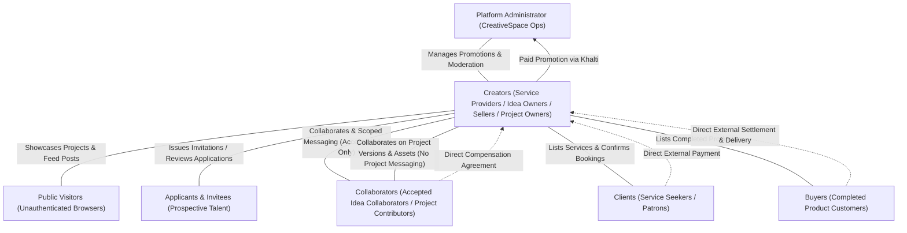

| Stakeholder Group | Primary Interests & Business Needs | Platform Value Proposition |
| :--- | :--- | :--- |
| **Platform Administrator / Owner** | Platform sustainability, content moderation, abuse prevention, brand consistency, promotion revenue growth. | Centralized governance tools, Khalti revenue records, content moderation tools, clear operational boundaries. |
| **Creators (Showcasers / Sellers / Service Providers / Project Owners)** | Professional reputation, client acquisition, creative collaboration, direct earnings retention, discoverability. | Comprehensive portfolio presentation, version tracking, booking management without commissions, direct buyer interactions. |
| **Idea Owners** | Recruiting skilled collaborators for creative concepts, managing team recruitment across 5 lifecycle stages, independently transitioning to Projects. | Dedicated Idea workspace, dual-stream intake (invitations & applications), scoped contextual messaging with accepted collaborators. |
| **Project Contributors** | Contributing specialized skills, creating new versions, uploading assets, having attribution preserved during the active Project. | Clear Project Contributor permissions, access to permitted drafts, active-Project attribution protection (post-deletion history subject to DEC-021). |
| **Idea Collaborators** | Contributing specialized skills, collaborating in focused channels, agreeing on compensation directly. | Searchable Idea directory, transparent application tracking, direct dialogue with Idea owners upon acceptance. |
| **Applicants & Invitees** | Discovering Ideas, applying to open roles, evaluating owner invitations. | Clear application submissions, invitation review, no unauthorized messaging spam. |
| **Clients (Service Seekers)** | Accessing creative talent, scheduling services, negotiating dates/times without friction. | Structured service listings, date/time booking requests, alternative-time negotiation. |
| **Buyers** | Discovering and purchasing finished creative products directly from original creators. | Searchable product marketplace, clear creator profiles, private structured purchase inquiries. |
| **Public Visitors** | Exploring creative work, discovering creators, viewing services and products. | Frictionless public exploration, open visibility of public portfolios, posts, and creator social links. |

---

## 7. User Roles and Business Responsibilities

### 7.1 Visitor (Unauthenticated Public User)
- **Definition:** An individual browsing CreativeSpace without an active authenticated session.
- **Permitted Actions:**
  - Browse and search **publicly accessible** portfolios, creative projects, and public project versions.
  - View public feedback submitted on publicly viewable project versions.
  - Browse the public Creative Feed and community showcase posts.
  - Browse the Explore page (Creators, Projects, Feed Posts, Ideas, Services, Completed Products).
  - View public creator profiles and publicly visible external social media links (Instagram, X, ArtStation, YouTube, GitHub, personal URLs).
  - View publicly accessible Idea listings (specifically Ideas in `Recruiting` status, subject to stakeholder decision DEC-018 regarding other lifecycle stages), public creator service listings, and completed product listings.
  - View the preserved public landing page.
- **Restricted Actions (Authentication Required):**
  - **Cannot access private, draft, or unreleased project versions or restricted media assets.** (Visitor access is strictly restricted to publicly accessible projects and versions; private and draft media remain protected).
  - Cannot publish projects, versions, posts, Ideas, services, or products.
  - Cannot submit feedback or comments on projects/posts.
  - Cannot apply to join Ideas or receive Idea invitations.
  - Cannot request creator service bookings or send alternative-time proposals.
  - Cannot submit structured product purchase inquiries.
  - Cannot access contextual messaging channels.
  - Cannot purchase paid promotions or submit abuse reports.

### 7.2 Registered User
- **Definition:** An authenticated individual possessing a validated CreativeSpace account (verified via email credential confirmation).
- **Capabilities & Responsibilities:**
  - Maintain personal profile information, avatar, biography, and external professional links.
  - Discover creative content and post constructive feedback on publicly open project versions.
  - Submit applications to join publicly listed Ideas (applications do not grant messaging access).
  - Submit booking requests for creator services (even when another client is currently selected for that slot), and initiate or respond to bidirectional alternative-time proposals and counter-proposals (`BOOK-006`, `DEC-017`).
  - Submit private, structured purchase inquiries for completed products.
  - Engage in contextual messaging strictly tied to active booking requests or accepted Idea collaborations.
  - Report inappropriate content, abusive users, or fraudulent listings to platform administrators.

### 7.3 Creator
- **Definition:** A registered user actively utilizing CreativeSpace to display creative work, offer services, organize Ideas, collaborate on Projects, or list completed products. (Every registered user has the native business capability to act as a Creator).
- **Capabilities & Responsibilities:**
  - **Portfolio & Projects:** Publish creative projects, upload media assets across supported formats, and manage project versions independently from posts.
  - **Project Collaboration:** As a Project Owner, manage contributors, project visibility, and project assets—including authority to remove or unpublish individual contributor versions/assets from the active Project view with attribution and audit metadata preserved (`DEC-020`), and archive or delete the Project (`PROJ-005`, subject to open `DEC-021`); as a Project Contributor, view drafts, upload creative assets, and create new versions with attribution preserved without modifying or deleting others' work.
  - **Showcase Feed:** Post creative updates, progress snapshots, and community announcements independently from projects.
  - **Idea Management:** Author Ideas, explicitly manage the 5-stage lifecycle (`Draft`, `Recruiting`, `In Progress`, `Completed`, `Archived`)—including reopening Completed/Archived Ideas back to `In Progress` (`DEC-015`) and transitioning `In Progress` back to `Recruiting` (`DEC-019`)—issue direct invitations to other creators, review inbound applications without platform capacity caps, and communicate with accepted collaborators via Idea-scoped messaging.
  - **Service Bookings:** Publish service listings with rates and availability parameters; review booking requests, negotiate alternative slots, select one client, receive a single 48-hour informational reminder, manually release selections if necessary, and manually confirm bookings upon independently verifying direct external payments.
  - **Marketplace:** Publish completed creative product listings with pricing; receive private, data-minimized buyer purchase inquiries; arrange external payment and fulfillment directly.
  - **Promotion:** Purchase package-defined visibility boosts with clear "Sponsored" labeling for eligible owned projects, posts, services, or products using the Khalti payment gateway (without guaranteed reach, impressions, ranking, or engagement outcomes).
  - **Compliance:** Ensure all uploaded media, listings, and communications comply with applicable copyright laws, community standards, and terms of service.

### 7.4 Administrator
- **Definition:** Authorized platform personnel responsible for operational governance, platform health, community standards, and promotion revenue records.
- **Capabilities & Responsibilities:**
  - **Account & Content Oversight:** Suspend or terminate accounts violating terms of service; moderate, hide, or remove infringing or inappropriate content.
  - **Report Triage:** Review flagged content and user reports with audit logs.
  - **Gated Message Inspection:** Inspect private conversations **only for legitimate, documented moderation purposes**, strictly limited to:
    1. A formal user abuse report involving a conversation or individual message.
    2. A documented Terms of Service investigation concerning a specific, credible concern.
    - *Access Controls:* Access is restricted to authorized personnel, limited to the minimum necessary content, and subject to mandatory audit logging. No routine, casual, unrestricted, or unnecessary conversation browsing is permitted.
  - **Promotion & Revenue Oversight:** Oversee paid promotion packages, monitor Khalti transaction logs, track platform promotional earnings, and manage promotion durations and statuses. (Promotion refund management is excluded from current release scope).
  - **Operational Boundary Enforcement:** Ensure the platform remains strictly separated from user-to-user financial settlements, escrow disputes, or delivery fulfillment claims.

---

## 8. Product Ecosystem and Module Overview

```mermaid
graph TB
    subgraph Brand & Landing
        Landing[8.1 Landing Page Preservation]
    end

    subgraph Core Identity & Discovery
        Auth[8.2 Authentication & Profiles]
        PublicSocial[Public Social Links]
        Explore[8.6 Explore Engine]
        Feed[8.5 Post Management]
    end

    subgraph Creative Work & Collaboration
        Projects[8.3 Project Management & Collaboration]
        Versions[8.4 Project Versions & Iterative Feedback]
        Feedback[Version Feedback Engine]
        ProjCollab[Project Collaboration: Owner & Contributor]
    end

    subgraph Ideation Hub
        Idea[8.7 Idea Collaboration]
        IdeaInvites[Owner Invitations Workflow]
        IdeaApps[Creator Applications Workflow]
    end

    subgraph Commercial Operations
        Booking[8.9 Creator Service Booking]
        Marketplace[8.10 Product Marketplace]
        Promotion[8.12 Khalti Promotions]
    end

    subgraph Governance & Scoped Comms
        Messaging[8.11 Scoped Messaging]
        Admin[8.13 Admin Governance]
    end

    Landing -.-> Auth
    Auth --> PublicSocial
    Auth --> Projects
    Auth --> Versions
    Projects --> Versions --> Feedback
    Projects --> ProjCollab
    Projects --> Explore
    Versions --> Explore
    Feed --> Explore

    Idea --> IdeaInvites
    Idea --> IdeaApps
    Idea -.->|"8.8 Cross-Module Principle: Idea & Project Independence (Manual Creation Only)"| Projects

    Booking --> Messaging
    Idea -->|Accepted Collaborators Only| Messaging

    Promotion -->|Package-Defined Placement (Sponsored Label)| Explore
    Promotion -.->|Where Package Applicable| Feed
    Admin --> Auth
    Admin --> Projects
    Admin --> Versions
    Admin --> Feed
    Admin --> Idea
    Admin --> Booking
    Admin --> Marketplace
    Admin --> Promotion
    Admin -.->|"Gated Inspection Only"| Messaging
```

### 8.1 Functional Module Catalog and Traceability
The CreativeSpace product ecosystem comprises thirteen primary functional modules, each corresponding directly to a detailed requirements domain in Section 9:
| Module ID | Module Title | Core Operational Domain & Primary Boundary |
| :--- | :--- | :--- |
| **8.1** | Landing Page Preservation | Protected brand visual identity, typography, layout, and artistic styling benchmark. |
| **8.2** | Authentication & Profiles | Email credential verification, creator profiles, and unrestricted public social links. |
| **8.3** | Project Management & Collaboration | Multi-media portfolio showcases, Project Owner and Contributor roles, active-Project attribution protection. |
| **8.4** | Project Versions & Iterative Feedback | Sequential multi-version progression; public feedback decoupled from private draft media. |
| **8.5** | Post Management (Creative Feed) | Chronological/curated community updates and peer commentary; strictly independent from Projects. |
| **8.6** | Explore Engine | Central multi-stream discovery index covering Creators, Projects, Posts, Ideas, Services, and Products. |
| **8.7** | Idea Collaboration | Five-stage operational lifecycle (`Draft`, `Recruiting`, `In Progress`, `Completed`, `Archived`), dual intake. |
| **8.8** | Idea & Project Independence *(Cross-Module Principle)* | Strict workflow isolation; manual project creation with zero automated data or collaborator transfer. |
| **8.9** | Creator Service Booking | Structured scheduling; selection without soft holds; single 48h reminder; 24h negotiation with dual holds. |
| **8.10** | Product Marketplace | Completed creative goods catalog; private data-minimized purchase inquiries; external fulfillment. |
| **8.11** | Scoped Messaging | Context-bound communications strictly tied to active bookings and accepted Idea collaborator teams. |
| **8.12** | Khalti Promotions | Platform monetization engine; creator-to-platform paid promotions; package-defined placement. |
| **8.13** | Admin Governance | Content and user moderation; abuse reporting; strictly gated administrative message inspection. |

### 8.2 Module Synergy and Separation Principles
1. **Landing Page as the Protected Visual Anchor:** The established landing page design, layout, aesthetic, and color scheme represent the visual foundation of the platform and must remain intact.
2. **Projects vs. Posts Independence:** Creative Projects (structured portfolios with versions) and Creative Posts (feed updates) are independent content types. Creating a Project does not auto-generate a Post; publishing a Post does not auto-generate a Project.
3. **Explore as the Aggregator:** Aggregates six distinct content streams: Creators, Projects, Feed Posts, Ideas, Services, and Completed Products. Promoted content receives package-defined promotional placement opportunities appropriate to its eligible content type with a clear "Sponsored" label (without guaranteed impressions, reach, or ranking outcomes).
4. **Idea Engine with Independent Dual Intake:** Supports both creator applications and owner invitations concurrently across a 5-stage lifecycle (`Draft`, `Recruiting`, `In Progress`, `Completed`, `Archived`) without platform-enforced capacity caps. Under DEC-015 (Approved / IDEA-006), the Idea Owner has authority to reopen Completed or Archived Ideas back to `In Progress` with active collaboration messaging restored. Under DEC-019 (Approved / IDEA-007), the Idea Owner may transition an Idea from `In Progress` back to `Recruiting` while preserving the existing roster and messaging history. Public visibility for `In Progress`, `Completed`, and `Archived` statuses remains an open stakeholder decision (DEC-018 / OPEN-002).
5. **Idea and Project Independence:** Ideas and Projects are separate entities and workflows. Creating a Project based on an Idea is an independent manual creator action. There is zero automatic transfer of metadata, assets, applications, or collaborators (IDEA-008).
6. **Project Collaboration Permissions:** Structured around two distinct roles: Project Owner and Project Contributor, with strict version attribution and prohibition of contributors overwriting or deleting other contributors' work (PROJ-001, PROJ-002, PROJ-003). Under DEC-020 (Approved / PROJ-004), the Project Owner has authority to remove or unpublish an individual contributor version or asset from the active Project view while preserving attribution and audit metadata. Contributor attribution retention upon entire project deletion remains an open stakeholder decision (DEC-021 / OPEN-003).
7. **Service Booking with Pure Operational Tracking:** Facilitates structured scheduling without soft holds (BOOK-001, BOOK-002, BOOK-003). New clients can request a slot even when another client is selected. Selected bookings trigger a single informational 48-hour reminder (BOOK-004) and can be manually released back to pending (BOOK-005). Competing requests close only upon manual confirmation. Alternative-time negotiation is bidirectional (DEC-017 Approved / BOOK-006, BOOK-007) with simultaneous dual slot holds (BOOK-008), while informational notice to new requesters during active holds remains an open stakeholder decision (DEC-016 / OPEN-001).
8. **Product Marketplace with Private Inquiries:** A catalog for finished creative goods with private, data-minimized purchase inquiries. The buyer and seller independently arrange and complete any physical or digital product fulfillment outside CreativeSpace. CreativeSpace does not manage or prescribe delivery methods or workflows, nor does it intermediate payments.
9. **Scoped Messaging Boundary:** Strictly limited to active bookings and accepted Idea collaborations. Terminal conversations transition to read-only archives. No marketplace chat or general messaging.
10. **Platform Promotion via Khalti:** Promoted content receives package-defined promotional placement opportunities appropriate to its eligible content type (Projects, Posts, Services, Products) with a clear Sponsored label appearing wherever the content is displayed as promoted (without guaranteed reach, impressions, ranking, or engagement outcomes). Promotion refund management is excluded from the current release scope.

---

## 9. Detailed Business Requirements

### 9.1 Landing Page Visual Identity & Preservation
- **BR-LAND-001 (Landing Page Preservation):** The existing CreativeSpace landing page design, visual identity, layout, color palette, typography, visual hierarchy, and overall aesthetic must be strictly preserved. Internal application pages (such as user dashboards, explore views, project editors, and booking interfaces) may be redesigned or harmonized with this aesthetic as necessary, but the public landing page represents a protected visual benchmark.
  - *Stakeholder:* Platform Owner, Visitors, Creators. *Priority:* Mandatory (P0).

### 9.2 Authentication & User Profile Management
- **BR-AUTH-001 (Account Registration & Credential Verification):** The platform shall allow visitors to register an account using an email address and secure password, verify ownership of their email address via a confirmation link, authenticate securely, and recover access via password reset. Email verification confirms credential ownership and does not imply identity or professional vetting.
  - *Stakeholder:* Registered Users, Visitors. *Priority:* Mandatory (P0).
- **BR-AUTH-002 (Creator Profile Customization):** The platform shall allow registered users to maintain a public creative profile consisting of a display name, unique username/handle, biographical statement, creative discipline/specialization, avatar image, and header banner.
  - *Stakeholder:* Creators. *Priority:* Mandatory (P0).
- **BR-AUTH-003 (Unrestricted Public Social Discovery):** The platform shall provide fields for creators to publish their external social media and professional website URLs (e.g., X, Instagram, ArtStation, GitHub, Behance, personal domain). These links **must be publicly visible to all visitors and users without requiring connection requests, friend approvals, or collaboration gating**.
  - *Stakeholder:* Creators, Visitors, Clients. *Priority:* Mandatory (P0).

### 9.3 Creative Projects, Portfolio & Project Collaboration
- **BR-PROJ-001 (Multi-Format Project Showcase):** The platform shall allow creators to create, edit, publish, archive, and delete creative projects. Each project must support a project title, category classification, descriptive overview, cover image, and associated digital creative assets across visual, audio, written, photographic, and multimedia formats.
  - *Stakeholder:* Creators, Visitors. *Priority:* Mandatory (P0).
- **BR-PROJ-002 (Project Visibility Controls):** The platform shall allow project owners to configure visibility settings (e.g., Public or Private/Draft) to control when a project appears in public feeds, creator profiles, and search results.
  - *Stakeholder:* Creators. *Priority:* Mandatory (P0).
- **BR-PROJ-003 (Independence from Creative Posts):** Creative Projects and Creative Posts are independent entities. Creating or publishing a Project **shall not automatically generate a Feed Post**. Creators retain full discretion to publish either independently.
  - *Stakeholder:* Creators. *Priority:* Mandatory (P0).
- **BR-PROJ-COLLAB-001 (Project Collaboration Roles & Permissions):**
  The platform shall support structured Project Collaboration governed by two distinct roles:
  1. **Project Owner Permissions:**
     - View and manage the entire Project.
     - View all Project versions and uploaded creative assets.
     - Create new versions and upload creative assets without silently overwriting or reattributing versions created by other contributors. (Project Owner authority to remove or unpublish individual contributor-uploaded versions or assets from the active Project view with attribution and audit logging is governed by `DEC-020` / `PROJ-004` below.)
     - Edit Project-level information (title, description, category, cover).
     - Manage Project visibility (public vs. private/draft).
     - Issue project-level invitations to other creators.
     - Remove project contributors.
     - Archive the Project.
     - Delete the Project entity (subject to appropriate administrative safeguards).
     - *Owner Removal of Individual Contributor Versions or Assets (DEC-020 Approved / PROJ-004):* The Project Owner has confirmed authority to remove or unpublish an individual version or creative asset contributed by a Project Contributor from the active Project view. When an Owner removes a contributor version or asset: (a) The version or asset is removed/unpublished from the active Project view; (b) Attribution for the removed work is strictly preserved in historical/audit logs (recording who created it, upload timestamp, version ID, and who removed it and when); (c) The removal does not delete or alter other versions or assets in the Project; (d) The removed contributor does not lose attribution for work they contributed. Contributors cannot remove or delete versions or assets contributed by other contributors, and removing a contributor does not automatically remove their contributions. Removal from the active Project must be distinguished from permanent historical erasure or purge; audit logging is mandatory.
     - *Disposition of Records Upon Entire Project Deletion (DEC-021 Open / OPEN-003):* The Project Owner may delete the entire Project entity (PROJ-005 Approved), but what happens to contributor attribution and historical contribution records upon complete project deletion remains an unresolved stakeholder decision (see Section 17, DEC-021).
  2. **Project Contributor Permissions:**
     - View the specific Project they were invited to.
     - View private draft versions when granted access through accepted project membership.
     - Upload creative assets and create new versions within the Project.
     - View other contributors' versions when access is permitted.
  3. **Project Contributor Restrictions:**
     - A Project Contributor **cannot** edit Project-level information.
     - A Project Contributor **cannot** change Project visibility.
     - A Project Contributor **cannot** invite other contributors.
     - A Project Contributor **cannot** remove contributors.
     - A Project Contributor **cannot** delete or archive the Project.
     - A Project Contributor **cannot** edit, overwrite, reattribute, or delete versions created by other contributors.
     - A Project Contributor **cannot** transfer Project ownership.
  - *Stakeholder:* Project Owners, Project Contributors. *Priority:* Mandatory (P0).
- **BR-PROJ-COLLAB-002 (Version Ownership, Attribution & Active-Project Protection):**
  - A contributor can create new versions and upload creative assets.
  - Contributors cannot modify, overwrite, reattribute, or delete another contributor's existing versions.
  - **Attribution Protection & Item Removal Boundary:** During the active Project lifecycle, attribution for uploaded assets and created versions must be strictly preserved; work cannot be silently overwritten or reattributed (`PROJ-003`). Contributors cannot modify, overwrite, reattribute, or delete another contributor's existing versions or assets (`PROJ-002`). Under `DEC-020` (Approved / `PROJ-004`), the Project Owner may remove or unpublish an individual contributor-uploaded version or asset from the active Project view with original contributor attribution and relevant audit/activity history preserved (distinct from permanent historical erasure or entire Project deletion under open `DEC-021`).
  - If a version requires correction, the standard workflow is for the appropriate contributor or Project Owner to create a new version with preserved attribution rather than overwriting another contributor's work. Under DEC-020 (Approved / PROJ-004), the Project Owner holds authority to unpublish or remove an individual contributor version/asset from the active project display, with mandatory audit logging and preserved attribution. Contributor attribution retention upon entire project deletion remains an open stakeholder decision (DEC-021 / OPEN-003).
  - Removing a contributor **must not automatically remove their contributions or erase their contribution history or attribution** during the active Project lifecycle.
  - Project ownership does not automatically transfer when a contributor leaves or is removed.
  - Contributor seats/memberships are personal and **strictly non-transferable**.
  - *Stakeholder:* Project Owners, Project Contributors. *Priority:* Mandatory (P0).

### 9.4 Project Versions & Iterative Feedback
- **BR-VERS-001 (Iterative Versioning System):** The platform shall allow creators and authorized contributors to create and submit multiple successive versions within a project to showcase development progression (with Project-level public vs. private/draft visibility remaining strictly controlled by the Project Owner; contributor version creation does not auto-publish private Projects). Each version shall maintain its own upload timestamp, version label, changelog notes, creator attribution, and media attachments.
  - *Stakeholder:* Creators, Project Contributors. *Priority:* Mandatory (P0).
- **BR-VERS-002 (Decoupled Permission Architecture):** The platform shall enforce strict separation between:
  1. *Version Media Visibility:* Who can access and view a specific version's media files (e.g., public vs. private draft).
  2. *Feedback Visibility:* Who can view comments and feedback submitted on a version.
  3. *Version Edit Permissions:* Strictly restricted to the version creator and authorized project members per role permissions.
  4. *Feedback Submission Permissions:* Permitted to authenticated registered users on publicly open versions.
  5. *Feedback Moderation Permissions:* Retained by the project owner and platform administrators.
  - *Crucial Rule:* Public feedback visibility does not automatically expose or make private draft media accessible; a private draft version's media remains restricted.
  - *Stakeholder:* Creators, Registered Users. *Priority:* Mandatory (P0).
- **BR-VERS-003 (Public Feedback Visibility):** In accordance with the agreed community standard, feedback submitted on publicly viewable project versions shall be viewable by everyone, fostering constructive community critique.
  - *Stakeholder:* Creators, Registered Users, Visitors. *Priority:* High (P1).

### 9.5 Creative Feed & Community Showcase
- **BR-FEED-001 (Creative Post Publication):** The platform shall allow creators to publish feed posts featuring media previews, progress snapshots, creative announcements, and commentary linked to their creator profile.
  - *Stakeholder:* Creators. *Priority:* Mandatory (P0).
- **BR-FEED-002 (Community Feed Interactivity):** The platform shall present a community feed enabling registered users to explore creative updates, like posts, and post constructive commentary without generic social networking clutter.
  - *Stakeholder:* Creators, Registered Users. *Priority:* Mandatory (P0).
- **BR-FEED-003 (Independence from Creative Projects):** Publishing a Feed Post **shall not automatically create or modify a Creative Project**. Posts remain standalone community updates.
  - *Stakeholder:* Creators. *Priority:* Mandatory (P0).

### 9.6 Explore Engine
- **BR-EXPL-001 (Unified Multi-Stream Discovery):** The platform shall provide an Explore hub enabling users and visitors to filter, search, and discover content across six distinct categories:
  1. *Creators* (by discipline, name, skills)
  2. *Projects* (by creative category, tags, recency)
  3. *Creative Posts* (by media type, recency)
  4. *Ideas Seeking Collaborators* (by category, required skills)
  5. *Creator Services* (by service type, price band)
  6. *Completed Creative Products* (by product category, price range)
  - *Stakeholder:* Visitors, Registered Users, Creators, Clients, Buyers. *Priority:* Mandatory (P0).
- **BR-EXPL-002 (Promoted Content Placement & Sponsored Label):** The Explore engine shall display actively promoted projects, posts, services, and products in designated package-defined sponsored discovery placements based on valid platform promotion purchases. All promoted items must display a clear **Sponsored** label. Promotion purchases grant package-defined placement opportunities but do not guarantee specific reach, impression volumes, search ranking positions, or user engagement outcomes.
  - *Stakeholder:* Creators, Platform Administrator. *Priority:* Mandatory (P0).

### 9.7 Idea Collaboration Management
- **BR-IDEA-001 (Idea Formulation & Publishing):** The platform shall allow creators (acting as Idea Owners) to formulate and publish collaborative Ideas. Each Idea must define a concept title, description, category, target objectives, specific collaborator roles/skills sought, and participation guidelines.
  - *Stakeholder:* Creators (Idea Owners). *Priority:* Mandatory (P0).
- **BR-IDEA-002 (Independent Dual-Intake Workflows):** The platform shall support two distinct, independently supported initiation workflows for Idea participation:
  1. *Creator Applications:* Any registered creator may independently submit an application expressing interest, stating their proposed contribution, and linking relevant portfolio work.
  2. *Owner Invitations:* The Idea owner may directly search for creators and extend a formal invitation.
  - *Crucial Rule:* These two workflows are **not mutually exclusive** for an Idea; an Idea owner may utilize both workflows concurrently to assemble a team.
  - *Stakeholder:* Creators, Idea Owners. *Priority:* Mandatory (P0).
- **BR-IDEA-003 (Non-Automatic Permission Granting & Non-Transferable Seats):** Neither the submission of an application nor the dispatch of an owner invitation shall grant collaborator status. Collaborator status and access shall only be established upon mutual agreement (Owner *Accepts* application OR Invitee *Accepts* invitation). Collaborator seats are personal and **strictly non-transferable**; if a collaborator leaves, inviting a replacement is a brand-new invitation.
  - *Stakeholder:* Idea Owners, Collaborators. *Priority:* Mandatory (P0).
- **BR-IDEA-004 (Approved 5-Stage Idea Lifecycle & Messaging Triggers):**
  The platform shall support exactly five operational Idea lifecycle statuses, with exact messaging triggers as follows:
  1. **Draft:** The Idea is being prepared; it is not publicly recruiting; the owner can edit all details. *Messaging Behavior:* No collaboration messaging channel exists.
  2. **Recruiting:** The Idea is published; it can receive creator applications; the owner can send direct invitations; applications and invitations operate concurrently. *Messaging Behavior:* Pending applicants and pending invitees have **zero messaging access**.
  3. **In Progress:** The owner is actively collaborating with accepted collaborators. *Messaging Behavior:* Collaboration messaging channel is active strictly for the Idea owner and accepted collaborators.
  4. **Completed:** The owner explicitly marks the Idea as completed; no new applications or invitations are accepted. *Messaging Behavior:* Collaboration context becomes terminal; messaging channel transitions to **read-only** archive; existing participants retain read-only view access; no new messages permitted.
  5. **Archived:** The Idea is no longer active; it is retained for reference; no new applications or invitations are accepted. *Messaging Behavior:* Messaging channel transitions to (or remains) **read-only** archive; existing participants retain read-only view access; no new messages permitted.
  - *Lifecycle Rules:* Only the Idea owner can change its lifecycle status; the platform must not automatically mark an Idea Completed just because collaborators have joined; the owner may archive an Idea without first marking it Completed; archived Ideas must not be automatically deleted.
  - *Reopening Policy (DEC-015 Approved / IDEA-006):* The Idea Owner has the authority to reopen a Completed or Archived Idea back to `In Progress`. Upon reopening, accepted collaborators retain their membership and active collaboration messaging access; existing applications, invitations, messages, and collaboration history are preserved; rejected applicants and rejected invitees are not automatically reactivated; and no Project is automatically created. The Idea Owner may subsequently transition the reopened Idea from `In Progress` to `Recruiting` if additional collaborators are needed.
  - *Mid-Project Recruitment Transitions (DEC-019 Approved / IDEA-007):* The Idea Owner has the authority to transition an Idea from `In Progress` back to `Recruiting` to seek additional collaborators (e.g. if a collaborator departs or additional skills are required). Existing accepted collaborators retain their team roster seats and collaboration messaging access; collaboration history and chat logs are preserved; and public applications and direct owner invitations are reopened.
  - *Public Discovery Scope (DEC-018 Open / OPEN-002):* `Draft` Ideas are confirmed strictly private to the owner. `Recruiting` Ideas are confirmed publicly discoverable without authentication to visitors and users on Explore to foster collaborator recruitment. Public discoverability and visibility rules for `In Progress`, `Completed`, and `Archived` Ideas across three tiers (unauthenticated visitors vs. registered users vs. private roster) remain an open stakeholder decision (see Section 17, DEC-018).
  - *Stakeholder:* Idea Owners, Collaborators. *Priority:* Mandatory (P0).
- **BR-IDEA-005 (Independent Direct Compensation):** Idea participants may establish mutual compensation, profit-sharing, or volunteer arrangements entirely between themselves. **CreativeSpace does not collect, verify, process, track, escrow, or refund Idea collaboration payments.**
  - *Stakeholder:* Idea Owners, Collaborators. *Priority:* Mandatory (P0).
- **BR-IDEA-006 (No Platform-Enforced Collaborator Capacity):** The platform **shall not enforce a global collaborator capacity, target team-size requirement, capacity-based application restriction, or capacity warning workflow**. The Idea owner manages applications and invitations at their own discretion.
  - *Stakeholder:* Idea Owners, Applicants. *Priority:* Mandatory (P0).

### 9.8 Idea and Project Independence & Manual Creation
- **BR-IDEA-PROJ-001 (Complete Independence of Ideas and Projects):** Ideas and Projects are separate, independent entities and workflows. Completing an Idea or working on an Idea does **not** automatically convert, transfer, or spawn a Creative Project.
  - *Stakeholder:* Idea Owners, Project Owners. *Priority:* Mandatory (P0).
- **BR-IDEA-PROJ-002 (Manual Project Creation & Zero Automatic Transfer):** If an Idea owner or creator wishes to develop a Creative Project based on an Idea, they must manually create a separate Creative Project. There is **zero automatic data transfer** from the Idea to the Project (no automatic copying of title, description, category, applications, invitations, collaborators, messages, discussion history, activity history, or applicant information).
  - *Stakeholder:* Idea Owners, Project Owners. *Priority:* Mandatory (P0).
- **BR-IDEA-PROJ-003 (Independent Project Collaboration):** Idea collaborators are **never automatically transferred** into Project collaborators. The Project owner may independently invite individuals to collaborate on the Project through the Project Collaboration workflow, and each invited creator must independently accept before gaining contributor access.
  - *Stakeholder:* Idea Owners, Project Owners, Collaborators. *Priority:* Mandatory (P0).

### 9.9 Creator Service Booking System
- **BR-BOOK-001 (Service Catalog Listing):** The platform shall allow creators to list professional creative services, detailing service titles, descriptions, deliverables, indicative base pricing/rates, typical turnaround times, and booking availability parameters.
  - *Stakeholder:* Creators, Clients. *Priority:* Mandatory (P0).
- **BR-BOOK-002 (Client Booking Request Initiation):** The platform shall enable authenticated clients to submit a booking request for a creator's service by specifying project requirements, scope notes, and requested date/time slots.
  - *Stakeholder:* Clients, Creators. *Priority:* Mandatory (P0).
- **BR-BOOK-003 (Multi-Client Slot Competition & Manual Selection Release):**
  - The platform shall allow multiple clients to submit booking requests for the same available calendar slot. The creator shall have the autonomy to evaluate competing requests and select one client to proceed.
  - **No Soft Booking Hold on Selection:** Selecting a client does **not** block new inbound booking requests. Other existing competing requests remain active and pending. New clients may continue to submit booking requests for that slot while another request is selected but unconfirmed. Selection alone does not confirm or reserve the slot against all other requests, does not constitute a slot hold, and does not create an exclusive reservation.
  - **Manual Selection Release & Resulting State:**
    1. The creator may manually release the selection if external arrangements fail or do not proceed.
    2. Upon manual release, the selected request returns to the appropriate **pending selection state** (e.g., `Pending` / `Requested`), provided the original request remains valid.
    3. The creator may separately decline or cancel the request if they do not wish to proceed with that client.
    4. Existing competing requests remain active and pending.
    5. New booking requests continue to be permitted.
    6. Releasing a selection does **not** automatically confirm another client.
    7. Releasing a selection does **not** automatically cancel the booking request.
  - *Stakeholder:* Creators, Clients. *Priority:* Mandatory (P0).
- **BR-BOOK-004 (External Settlement, Manual Confirmation & Single 48-Hour Reminder):**
  - All booking payments take place directly between the client and creator outside CreativeSpace.
  - CreativeSpace **must not verify, process, or record external payment details** (such as transaction IDs, bank receipts, payment screenshots, or payment amounts).
  - The creator independently checks whether payment was received and **manually confirms the booking** within CreativeSpace. CreativeSpace records only the operational booking confirmation and status history.
  - **Single 48-Hour Informational Reminder:** If a selected booking remains unconfirmed after 48 hours, the system shall issue a **single informational reminder** to the creator prompting them to confirm receipt or manually release the selection. The reminder is strictly informational and is not a recurring reminder schedule; it must **never automatically cancel, decline, release, or alter the booking**. No automatic cancellation timer shall exist.
  - **Closure of Competing Requests:** **Only after the creator manually confirms the booking shall the system automatically decline or close other competing requests occupying that confirmed slot.**
  - *Stakeholder:* Creators, Clients. *Priority:* Mandatory (P0).
- **BR-BOOK-005 (Alternative-Time Negotiation Lifecycle, Dual Slot Holds & Distinct Outcomes):**
  - **Bidirectional Negotiation (DEC-017 Approved / BOOK-006, BOOK-007):** Alternative-time negotiation is bidirectional. Either the creator or the client can propose an alternative calendar date/time or submit counter-proposals during booking scheduling. Proposing an alternative time does not require or imply prior client selection.
  - **Dual Slot Holds During Active Negotiation (BOOK-008 Approved):**
    - While an alternative-time negotiation is unresolved, both the *Original Requested Slot* ($S_1$) and the *Currently Proposed Alternative Slot* ($S_2$) are temporarily held for this specific booking negotiation to prevent conflicting commitments involving either slot. Historical proposals that have been superseded must not indefinitely retain additional slot holds; only $S_1$ and the currently active proposed alternative $S_2$ are subject to the simultaneous-hold rule.
    - **Handling Inbound Requests During Negotiation (Approved Queue Rules; Requester Notice Open Under DEC-016 / OPEN-001):**
      - Inbound booking requests for $S_1$ or $S_2$ may still be submitted into the creator's queue as pending requests, but must not silently displace or override either active negotiation hold.
      - Overlapping confirmed bookings are strictly prevented: the platform will not permit confirming another booking occupying $S_1$ or $S_2$ while the active negotiation hold is unresolved.
      - This concurrency control is strictly limited to the active 24-hour negotiation window and does not introduce a general soft booking hold or a permanent restriction on new inbound requests.
      - If a creator wishes to confirm another client occupying $S_1$ or $S_2$, they must first resolve or terminate the active negotiation.
      - *Open Requester Informational Notice (`DEC-016` / `OPEN-001`):* While the concurrent $S_1$/$S_2$ holds, pending queue entry, conflict prevention, and immediate release of superseded alternative slots are **approved** rules, the sole unresolved stakeholder question under `DEC-016` is whether a new requester should receive an explicit informational notice when requesting a held slot.
  - **Response Window & Bidirectional Timer Reset (BOOK-007 Approved):** Whichever party receives an alternative proposal or counter-proposal has a **strict 24-hour response window** to accept, decline, or submit a counter-proposal. Any new counter-proposal or modified time submission **resets the 24-hour response timer** and shifts the response obligation to the recipient of the latest proposal.
  - **Separate State Management (BOOK-012 Approved):** Booking main status, alternative-time negotiation status (`Pending`, `Accepted`, `Declined`, `Expired`), and booking activity history are separate concepts. "Declined" and "Expired" are negotiation outcomes, not automatic booking cancellation states.
  - **Finalized Negotiation Outcomes (BOOK-009, BOOK-010, BOOK-011 Approved):**
    - **Outcome A (Receiving Party Accepts Alternative):** Update the booking's requested time to the accepted alternative ($S_2$); release original slot ($S_1$); preserve the booking's prior selection state (if already selected, remains selected; if not selected, returns to pending selection state).
    - **Outcome B (Receiving Party Declines Alternative):** End alternative-time negotiation; restore original booking arrangement on $S_1$; release alternative slot ($S_2$); preserve original slot for the client if the original request remains valid; preserve the booking's prior selection state (if selected, remains selected; if not selected, returns to pending state). Parent booking on $S_1$ is NOT cancelled.
    - **Outcome C (Receiving Party Does Not Respond / Expired):** Treat alternative proposal as expired after 24 hours; restore original booking arrangement on $S_1$; release alternative slot ($S_2$); preserve original slot for the client if the original request remains valid; preserve the booking's prior selection state. Parent booking on $S_1$ is NOT cancelled.
  - *Stakeholder:* Creators, Clients. *Priority:* Mandatory (P0).
- **BR-BOOK-006 (Operational Status Tracking):** The platform shall maintain an operational activity history across the booking lifecycle (*Requested*, *Negotiating*, *Selected*, *Confirmed*, *Completed*, *Cancelled*), recording status changes without recording financial transaction data.
  - *Stakeholder:* Creators, Clients. *Priority:* High (P1).

### 9.10 Completed Creative Product Marketplace
- **BR-MKT-001 (Completed Product Listings Only):** The platform shall allow creators to publish listings for **completed creative products only** (e.g., finalized design templates, artwork prints, sound packs, font packages, craft assets). Listings must include product title, description, category, preview media, and asking price.
  - *Explicit Exclusion:* Listings for unfinished Ideas, speculative concepts, funding requests, or prototype shares are strictly prohibited.
  - *Stakeholder:* Creators, Buyers. *Priority:* Mandatory (P0).
- **BR-MKT-002 (Structured Inquiries, Privacy & Data Minimization):**
  - The platform shall allow authenticated buyers to submit a structured purchase inquiry for a listed product.
  - **Inquiry Privacy:** Marketplace inquiries are strictly private to the buyer and seller. The buyer can view their own submitted inquiry; the seller can view inquiries submitted for their own listings. Other buyers, other sellers, and the public cannot access private inquiry details.
  - **Data Minimization:** The inquiry record captures only minimal necessary information: buyer's name from their CreativeSpace profile, inquiry message, account email (only where necessary), and an optional external contact handle. **A phone number must not be required.** No unnecessary personal information shall be collected.
  - **No Marketplace Chat:** The platform provides no marketplace chat or direct messaging channels for product sales. Further arrangements occur externally.
  - **No Delivery/Fulfillment Management:** The buyer and seller independently arrange and complete any physical or digital product fulfillment outside CreativeSpace. CreativeSpace does not manage, prescribe, track, enforce, or administer fulfillment methods or workflows, and does not provide shipping integrations, shipment tracking, digital download delivery pipelines, delivery-status management, fulfillment workflow management, or delivery-dispute resolution.
  - **Retention Policy:** The proposed automatic 90-day deletion rule is deferred. Inquiry data is retained according to an appropriately justified future retention policy based on business purpose and legal obligations.
  - *Stakeholder:* Creators, Buyers. *Priority:* Mandatory (P0).
- **BR-MKT-003 (Creator Listing Availability Management):** Creators shall have the capability to independently manage the availability of their product listings (e.g., toggling a listing active or inactive). Specific product lifecycle statuses (such as Reserved or Sold Out) are subject to finalization. Listing availability management is an independent creator catalog control and is not a delivery status, an order fulfillment status, a shipment status, or a required completion transition. CreativeSpace provides no order-management features or platform-managed purchase workflows.
  - *Stakeholder:* Creators. *Priority:* High (P1).

### 9.11 Scoped Contextual Messaging
- **BR-MSG-001 (Strictly Scoped Contextual Messaging):** The platform shall provide direct messaging capabilities **strictly confined to two functional contexts**:
  1. *Booking Communications:* Between an active client and creator regarding a specific booking request.
  2. *Idea Collaboration Communications:* Between the Idea owner and **accepted Idea collaborators only**.
  - *Crucial Rule:* Applicants **must not** receive collaboration messaging access merely by applying. An invited creator gains messaging access only after accepting the invitation.
  - *Explicit Exclusion:* General-purpose instant messaging, social chat, marketplace chat, and open networking channels are strictly prohibited.
  - *Stakeholder:* Creators, Clients, Collaborators. *Priority:* Mandatory (P0).
- **BR-MSG-002 (Terminal State Read-Only Archival & Message Retention):**
  - Active conversations remain accessible to their authorized participants.
  - When a booking reaches a terminal state (completed or cancelled) or an Idea collaboration context becomes terminal (`Completed` or `Archived`), the corresponding conversation becomes **read-only**.
  - Participants can continue viewing read-only conversations, but **cannot send new messages**.
  - **No User Message Deletion in Initial Release:** Users cannot delete individual messages in completed conversations in the initial release.
  - **Deferred Deletion Duration:** The previously proposed 180-day automatic deletion rule is deferred. The exact retention period will be established in a future retention policy accounting for legitimate moderation investigations, abuse reports, and applicable legal obligations.
  - **Reporting in Read-Only Archives:** Terminal read-only status prevents sending new messages, but **does not prevent participants from reporting previously received abusive messages** inside a read-only or archived conversation. Submitting a report does **not** reopen the conversation, restore messaging capability, or alter the terminal conversation state.
  - **Administrator Inspection Boundary:** Administrator access to conversation content (active or read-only) is strictly restricted to legitimate formal abuse reports or documented Terms of Service investigations by authorized personnel accessing minimum necessary content with mandatory audit logging under `BR-MOD-003` (no general browsing).
  - *Stakeholder:* Creators, Clients, Collaborators. *Priority:* Medium (P2).

### 9.12 Paid Platform Promotions (Monetization Engine)
- **BR-PROM-001 (Exclusive Platform Monetization Model):** The platform's sole revenue stream shall be the sale of **Paid Promotions** to creators wishing to boost the visibility of eligible projects, feed posts, service listings, or product listings.
  - *Stakeholder:* Platform Administrator, Creators. *Priority:* Mandatory (P0).
- **BR-PROM-002 (Eligible Content Types & Placement Mappings):**
  - Exactly four content types are eligible for paid promotion:
    1. *Projects*
    2. *Posts*
    3. *Services*
    4. *Marketplace Products*
  - Promotion placement eligibility depends on the promoted content type and the selected promotion package.
  - Promoted content receives package-defined promotional placement opportunities appropriate to its eligible content type. A clear **Sponsored** label must appear wherever the content is displayed as promoted.
  - Not every content type automatically qualifies for every placement. Specific content-type-to-placement mappings and commercial package configurations must be finalized before PRD approval.
  - **No Performance Guarantees:** Paid promotion purchases provide package-defined promotional visibility opportunities, but do not provide guaranteed impression volumes, reach, ranking positions, engagement, or commercial conversion outcomes.
  - *Stakeholder:* Platform Administrator, Creators. *Priority:* Mandatory (P0).
- **BR-PROM-003 (Promotion Eligibility & Ownership Restrictions):**
  - Promotion eligibility strictly follows content visibility, publication, and moderation rules.
  - Promoting an item **must never bypass**:
    1. Private visibility restrictions.
    2. Draft or unpublished status restrictions.
    3. Inactive listing restrictions.
    4. Content moderation restrictions.
    5. Content ownership restrictions.
  - Only the authenticated account that owns the eligible content can purchase its promotion. (This refers strictly to content ownership by the authenticated creator account and must not be confused with identity or professional creator verification badges, which remain deferred under DEC-008).
  - Paid promotions must not be confused with general subscriptions or platform membership fees.
  - *Stakeholder:* Creators, Platform Administrator. *Priority:* Mandatory (P0).
- **BR-PROM-004 (Integrated Khalti Payment Gateway):** The platform shall integrate the **Khalti** payment gateway exclusively for processing promotion purchases paid by creators to CreativeSpace. The system must verify Khalti payment callbacks, log platform transaction references, and automatically activate the promotion upon payment settlement.
  - *Stakeholder:* Platform Administrator, Creators. *Priority:* Mandatory (P0).
- **BR-PROM-005 (Promotion Refunds Excluded from Current Scope):**
  - A dedicated promotion refund-management software feature (refund request interfaces, approval workflows, automated processing, credits, refund dashboards) is **outside the current product scope**.
  - The exclusion of dedicated refund software features represents a product release boundary and must not be interpreted as a waiver of applicable statutory consumer rights, mandatory payment provider rules, or legal obligations, which will be handled through standard operational support channels.
  - *Stakeholder:* Platform Administrator, Creators. *Priority:* Mandatory (P0).

### 9.13 Content Moderation, Privacy & Platform Governance
- **BR-MOD-001 (User Reporting Mechanism):** The platform shall enable registered users to submit structured abuse reports against projects, posts, comments, Idea listings, service offerings, product listings, or profile abuse, selecting standardized violation categories (e.g., Copyright Infringement, Harassment, Explicit/Prohibited Content, Fraudulent Listings).
  - *Stakeholder:* Registered Users, Platform Administrator. *Priority:* Mandatory (P0).
- **BR-MOD-002 (Administrative Moderation Actions):** Platform administrators shall possess operational tools to review reported content, issue warnings, unpublish or redact offending content, and temporarily suspend or permanently terminate offending accounts.
  - *Stakeholder:* Platform Administrator. *Priority:* Mandatory (P0).
- **BR-MOD-003 (Contextual Message Reporting & Strictly Gated Privacy Boundary):**
  - Users participating in an **active or read-only/archived** booking or accepted Idea messaging channel may submit an abuse report against a previously received individual message or conversation thread. Reporting an item in a read-only archive **does not reopen the conversation**, restore messaging, or alter its terminal status.
  - **Administrator Access Boundary:** Platform administrators do **not** possess routine, casual, unrestricted, or unnecessary access to private user conversations, and no general conversation-browsing feature exists. Administrator inspection of conversation content is strictly restricted to legitimate, documented moderation purposes, limited to:
    1. A formal user abuse report involving a conversation or individual message (active or read-only).
    2. A documented Terms of Service investigation concerning a specific, credible concern.
  - In both situations, inspection is restricted to authorized administrative personnel, limited to the minimum necessary conversation content, and subject to mandatory audit logging.
  - *Stakeholder:* Registered Users, Platform Administrator. *Priority:* Mandatory (P0).

---

## 10. Business Processes and Workflows

### 10.1 User Registration & Creator Profile Onboarding
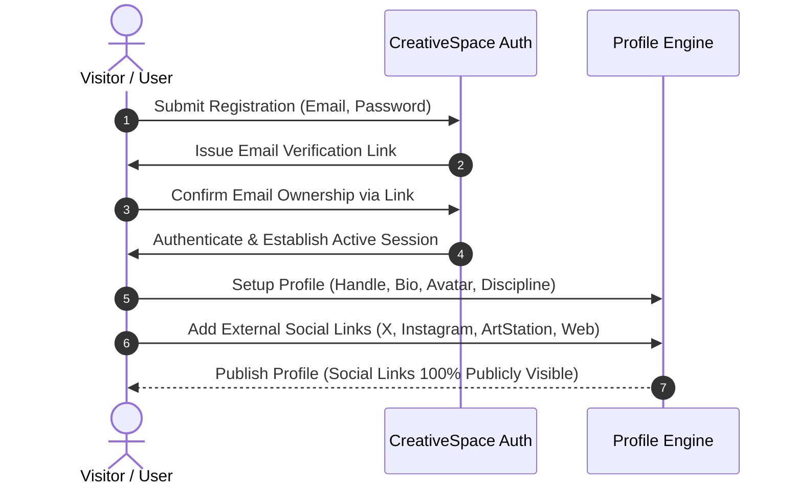
1. Visitor submits email, handle, and password.
2. System sends an email verification link to verify credential ownership (this does not constitute identity or professional verification).
3. User confirms email ownership and system establishes an authenticated session.
4. User configures public creator profile, adding bio, specialization, and external portfolio/social links.
5. System publishes profile with external social links openly visible to all visitors without connection barriers.

---

### 10.2 Project Showcase, Versioning & Feedback Lifecycle
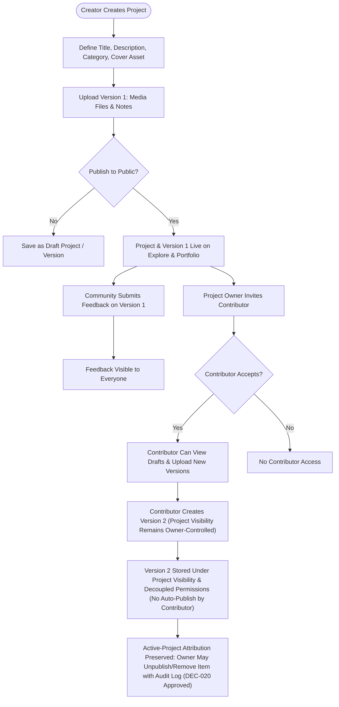
1. Creator creates a project with title, description, category, and cover asset. (This action does **not** create a Feed Post).
2. Creator uploads initial version assets (Version 1) with development notes.
3. Project Owner sets Project-level visibility (`Public` or `Private/Draft`). When Public, the Project appears in portfolio and Explore.
4. Authenticated community members inspect Version 1 and submit constructive feedback. Feedback is publicly viewable by all users and visitors without exposing private draft media.
5. Project Owner may invite Project Contributors. If accepted, the contributor can view permitted drafts and upload assets or create new versions (`V2`) without overwriting prior contributions. Contributors **cannot** change Project-level visibility; creating a new version does not automatically publish a private Project or draft publicly.
6. During the active Project lifecycle, attribution for versions and assets is strictly preserved. Contributors cannot modify or delete work contributed by other contributors (`PROJ-002`, `PROJ-003`), and removing a contributor does not automatically remove their contributions. Under `DEC-020` (Approved / `PROJ-004`), the Project Owner may remove or unpublish an individual contributor-uploaded version or asset from the active Project view while preserving contributor attribution and mandatory audit metadata (identifying who removed the item, when it was removed, and which version/asset was affected), distinct from permanent historical erasure or entire Project deletion (`DEC-021` remains OPEN).

---

### 10.3 Creative Feed Discovery & Post Lifecycle
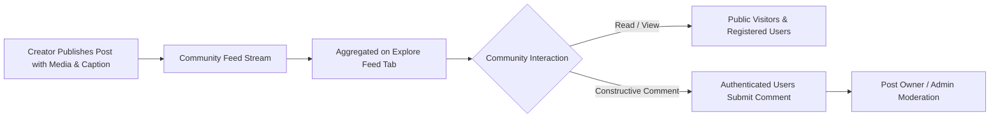
1. Creator posts an update, artwork preview, or announcement. (This action does **not** create a Creative Project).
2. Post broadcasts to the Community Feed and Explore Feed tab.
3. Public visitors and registered users view the post and creator details.
4. Authenticated registered users submit comments and likes.
5. Inappropriate comments are subject to Post Owner or administrative moderation (strictly separate from Project collaboration roles).

---

### 10.4 Idea Collaboration Lifecycle: 5-Stage Lifecycle & Dual Intake
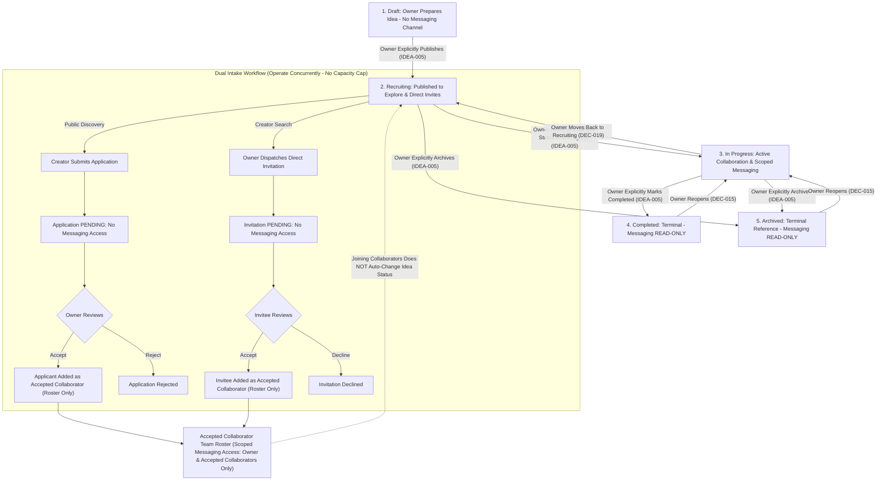
1. **1. Draft:** Owner authors Idea. Not publicly recruiting. Private to owner. No messaging channel exists.
2. **2. Recruiting:** Idea published by Idea Owner. Publicly discoverable on Explore for collaborator recruitment (`OPEN-002` / `DEC-018`). Concurrent dual intake: creators apply independently, and owner sends direct invitations (`IDEA-001`). No platform capacity cap is enforced.
3. **Pending Privacy & Collaborator Acceptance:** Applicants and invitees have **zero messaging access** while pending (`IDEA-004`). Acceptance of an application (`IDEA-002`) or invitation (`IDEA-003`) adds the creator as an accepted collaborator on the Idea roster (permitting Owner-and-accepted-collaborator Idea messaging) and **does not automatically change the Idea's lifecycle status**.
4. **3. In Progress (Owner-Controlled Transition Only):** Only the Idea Owner can explicitly change the lifecycle status from `Recruiting` to `In Progress` (`IDEA-005`). Accepted collaborators joining never automatically marks an Idea as `In Progress` or `Completed`. Only the Owner and accepted collaborators can access Idea collaboration messaging.
5. **4. Completed / 5. Archived:** Explicitly marked by owner (`IDEA-005`). Collaboration context becomes terminal; messaging channel becomes **read-only** (participants can view history; no new messages permitted). Retained for reference without automated deletion.
- **Idea Lifecycle Reopening (DEC-015 Approved / IDEA-006):** The Idea Owner has the authority to reopen a Completed or Archived Idea back to `In Progress`. Accepted collaborators retain their membership and active collaboration messaging access; existing applications, invitations, messages, and collaboration history are preserved; rejected applicants and rejected invitees are not automatically reactivated; and no Project is automatically created. The Idea Owner may subsequently transition the reopened Idea from `In Progress` to `Recruiting` if additional collaborators are needed.
- **In Progress to Recruiting Transition (DEC-019 Approved / IDEA-007):** The Idea Owner has the authority to move an Idea from `In Progress` back to `Recruiting` to seek additional collaborators while preserving the existing team roster and messaging history.
- **Public Visibility Scope (DEC-018 Open / OPEN-002):** `Draft` Ideas are confirmed private; `Recruiting` Ideas are confirmed publicly discoverable without authentication; public discoverability for `In Progress`, `Completed`, and `Archived` across three visibility tiers remains an open stakeholder decision (see Section 17, DEC-018 / OPEN-002).

---

### 10.5 Idea and Project Independence: Manual Project Creation
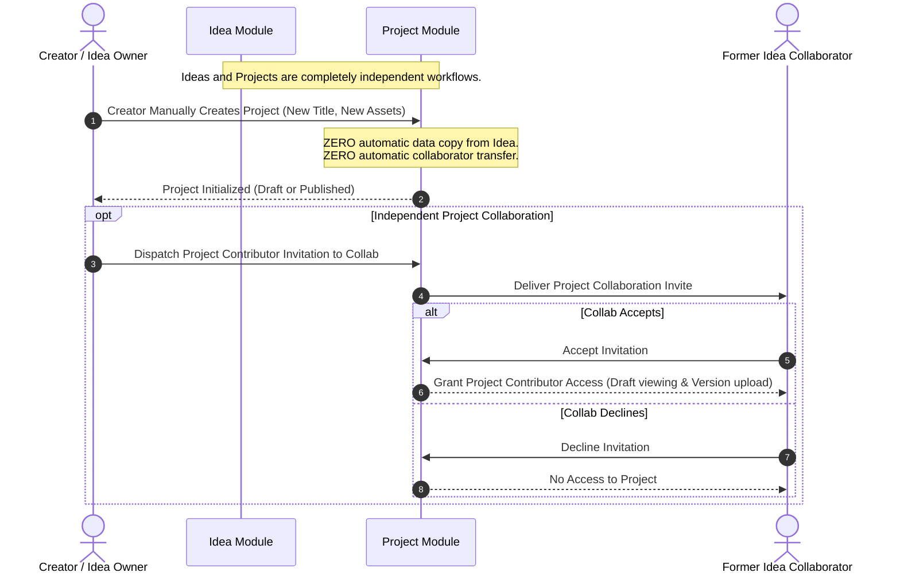
1. Ideas and Projects are separate entities.
2. If a creator develops a Project based on an Idea, they manually create a Project.
3. **Zero Automatic Data Transfer:** Title, description, assets, history, and applications do **not** copy automatically.
4. **Zero Automatic Collaborator Transfer:** Idea collaborators never become Project collaborators automatically.
5. The Project owner may independently issue Project collaboration invitations under the Project collaboration workflow.

---

### 10.6 Service Booking Lifecycle: Selection, Reminders & Confirmation
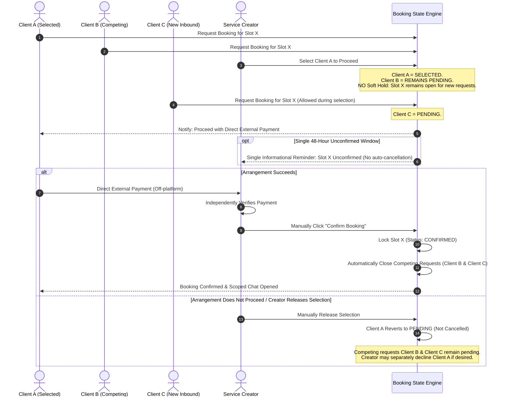
1. Multiple clients request the same calendar slot.
2. Creator selects Client A. Client A transitions to `SELECTED`.
3. **No Soft Hold:** New client requests (Client C) can still be submitted for that slot. Existing requests (Client B) remain pending.
4. If unconfirmed after 48 hours, system issues a **single informational reminder** to the creator (not recurring; no automatic cancellation).
5. **Manual Selection Release:** If arrangements fail, creator may manually release the selection. Client A returns to `PENDING` (not cancelled). Competing requests remain pending.
6. When external payment is verified, creator manually confirms the booking.
7. Only then does the slot lock and competing requests close automatically.

---

### 10.7 Alternative-Time Negotiation Lifecycle (Bidirectional Flow, Dual Slot Holds & Approved Outcomes)
```mermaid
flowchart TD
    subgraph ProposalInitiation["Alternative Proposal Initiation - Before or After Selection (DEC-017 / BOOK-006 Approved)"]
        Init["Creator or Client Proposes Alternative Slot S2 for Booking on Original Slot S1"]
    end

    subgraph ActiveNegotiation["Active Bidirectional Negotiation (24-Hour Response Window)"]
        subgraph DualHolds["Simultaneous Dual Slot Holds (Only S1 & Currently Active S2 Held - BOOK-008)"]
            HoldS1["Original Slot S1 Held<br/>(Protected from conflicting confirmation)"]
            HoldS2["Currently Active Proposed Slot S2 Held<br/>(Protected from conflicting confirmation)"]
        end
        PendingQueue["Approved Queue Rule: New Inbound Requests for Held S1/S2 Enter Pending Queue<br/>(Cannot override holds or be confirmed in conflict - BOOK-008)"]
        NoticeOpen["Open Question (DEC-016): Whether New Requesters Receive an Informational Hold Notice"]
        Timer["24-Hour Response Window Active<br/>(Recipient of Latest Proposal Must Respond)"]
        CounterProp["Counter-Proposal / Modified Time Submitted (Creator or Client)"]
        ReleaseOld["Superseded Alternative Slot Released Immediately;<br/>Hold Applied Only to S1 and New Active S2"]
        ResetTimer["24-Hour Timer Resets & Responding Party Shifts to New Recipient"]
    end

    subgraph NegotiationOutcomes["Three Mutually Exclusive Negotiation Outcomes (Parent Booking Remains Intact - BOOK-012)"]
        subgraph OutcomeA["Outcome A: Recipient Accepts S2 (BOOK-009)"]
            AcceptAction["Recipient Accepts Proposal"] --> UpdateSlot["Booking Slot Updated to Accepted S2"]
            UpdateSlot --> RelS1["Original Slot S1 Released"]
            RelS1 --> PresA["Prior Selection State Preserved<br/>(Selected remains Selected; Pending remains Pending)"]
        end

        subgraph OutcomeB["Outcome B: Recipient Declines S2 (BOOK-010)"]
            DeclineAction["Recipient Declines Proposal"] --> RelS2_B["Active Alternative Slot S2 Released"]
            RelS2_B --> RestS1_B["Original Booking Arrangement on S1 Restored"]
            RestS1_B --> PresB["Prior Selection State Preserved<br/>(Negotiation Outcome Only - NOT Booking Cancellation)"]
        end

        subgraph OutcomeC["Outcome C: 24h Window Expires (BOOK-011)"]
            ExpireAction["24-Hour Timer Expires Without Response"] --> RelS2_C["Active Alternative Slot S2 Released"]
            RelS2_C --> RestS1_C["Original Booking Arrangement on S1 Restored"]
            RestS1_C --> PresC["Prior Selection State Preserved<br/>(Negotiation Timeout Only - NOT Booking Cancellation)"]
        end
    end

    Init --> ActiveNegotiation
    DualHolds --- PendingQueue
    PendingQueue -.-> NoticeOpen
    DualHolds --- Timer
    Timer -->|Recipient Counter-Proposes| CounterProp
    CounterProp --> ReleaseOld
    ReleaseOld --> ResetTimer
    ResetTimer --> Timer

    Timer -->|Recipient Accepts| OutcomeA
    Timer -->|Recipient Declines| OutcomeB
    Timer -->|24-Hour Expiry| OutcomeC
```
1. **Proposal & Simultaneous Dual Slot Holds:** Either creator or client may propose an alternative calendar Slot $S_2$ (before or after client selection) for a booking originally requested on Slot $S_1$ (`DEC-017` Approved / `BOOK-006`). Both $S_1$ and the currently active proposed slot $S_2$ are held simultaneously to prevent conflicting commitments involving either slot during the active 24-hour response window (`BOOK-008`).
2. **Approved Inbound Queue & Hold Rules vs. Open Notice (`DEC-016`):** As an approved booking rule (`BOOK-008`), new inbound booking requests for $S_1$ or $S_2$ may enter the creator's pending queue, cannot displace or override active holds, and cannot be confirmed in conflict with them while negotiation remains active. Only the informational-notice display question—whether a prospective requester should receive a notice that the requested slot is held during another negotiation—remains an **open** stakeholder decision under `DEC-016` (`OPEN-001`).
3. **24-Hour Timer, Bidirectional Resets & Superseded Slot Release:** Whichever party receives the latest proposal or counter-proposal has a strict 24-hour response window to accept, decline, or submit a counter-proposal (`DEC-017` Approved / `BOOK-007`). When a new counter-proposal or modified time replaces the current alternative: (a) the superseded alternative slot is immediately released (historical superseded proposals never retain indefinite slot holds); (b) the new active alternative slot is held alongside $S_1$; (c) the 24-hour timer resets; and (d) the response obligation shifts to the recipient of the latest proposal.
4. **Outcome A (Accepted Alternative):** The receiving party accepts $S_2$ within the 24-hour window (BOOK-009). The booking slot is updated to $S_2$; original slot $S_1$ is released; and the booking's prior selection state is preserved (if already selected, remains selected; if pending, returns to pending selection state).
5. **Outcome B (Declined Alternative):** The receiving party declines $S_2$ (BOOK-010). The negotiation concludes; alternative slot $S_2$ is released; the original booking arrangement on $S_1$ is restored; and the booking's prior selection state is preserved.
6. **Outcome C (Expired Proposal):** The proposal reaches the 24-hour timeout without response (BOOK-011). The alternative proposal expires; alternative slot $S_2$ is released; the original booking arrangement on $S_1$ is restored; and the booking's prior selection state is preserved.
7. **Non-Cancellation Guarantee:** Neither Outcome B (Declined) nor Outcome C (Expired) automatically cancels or declines the parent booking request; the request remains intact on $S_1$ preserving its selection status.

---

### 10.8 Completed Product Marketplace: Inquiries & External Fulfillment
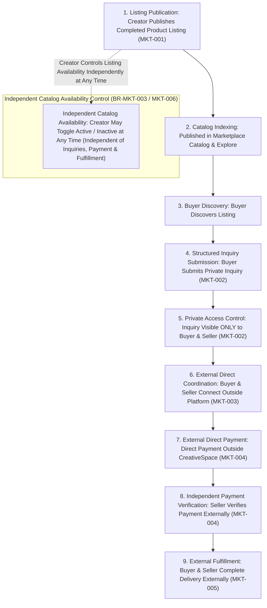
1. **Listing Publication (Stage 1):** The creator publishes a completed product listing with pricing and preview media (MKT-001).
2. **Catalog Indexing (Stage 2):** The listing appears in the Marketplace catalog and Explore engine.
3. **Buyer Discovery (Stage 3):** A prospective buyer browses and discovers the product.
4. **Structured Inquiry Submission (Stage 4):** The buyer submits a private structured purchase inquiry, capturing buyer name from profile, inquiry message, account email collected only where necessary, and an optional external contact handle; a phone number is not required (MKT-002).
5. **Private Access Control (Stage 5):** The inquiry record is visible strictly to the submitting buyer and the listing seller (MKT-002). No marketplace chat or public comments exist on CreativeSpace (MKT-003).
6. **External Direct Coordination (Stage 6):** Buyer and seller establish direct external communication using the provided contact handles or email to coordinate purchase terms (MKT-003).
7. **External Direct Payment (Stage 7):** All completed product payments occur directly between buyer and seller outside CreativeSpace. CreativeSpace does not collect, process, verify, record, escrow, or refund marketplace funds (FIN-005, MKT-004).
8. **Independent Payment Verification (Stage 8):** The seller independently verifies that payment has been received in their external account outside the platform (MKT-004).
9. **External Fulfillment (Stage 9):** The buyer and seller independently arrange and complete any physical or digital product fulfillment outside CreativeSpace. CreativeSpace does not manage, prescribe, track, enforce, or administer fulfillment methods or workflows, and does not provide shipping integrations, shipment tracking, digital download delivery pipelines, delivery-status management, fulfillment workflow management, or delivery-dispute resolution (MKT-005).
10. **Independent Listing Availability Management (Parallel Catalog Control — Not a Fulfillment Stage):** At any appropriate time completely independent of buyer inquiries, external payment arrangements, seller payment verification, or external delivery/fulfillment, the creator may toggle their listing's Active/Inactive availability (`BR-MKT-003`, `MKT-006`). Listing availability is strictly a catalog visibility/availability control—never a post-fulfillment consequence, delivery status, shipment status, or order workflow. CreativeSpace's Marketplace remains limited to completed-product listings, structured inquiries, agreed purchase/order information, and relevant operational history.

---

### 10.9 Platform Promotion Lifecycle (Khalti Settlement & Sponsored Label)
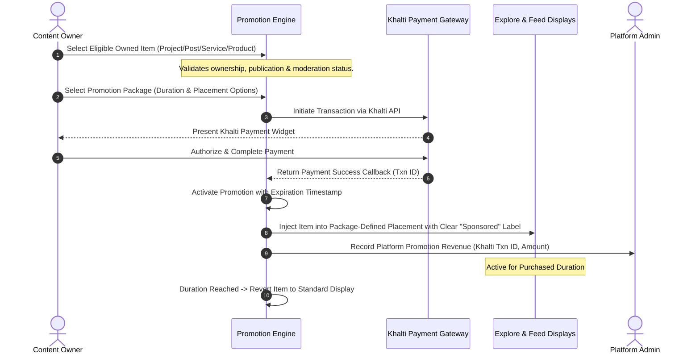
1. Content owner selects an eligible published item (Project, Post, Service, or Product).
2. Ownership, publication, visibility, and moderation eligibility are verified (privacy settings cannot be bypassed; only authenticated content owner can purchase).
3. Owner selects an approved promotion package corresponding to the content type and completes payment via Khalti.
4. System activates promotion and delivers package-defined promotional placement opportunities appropriate to its eligible content type, with a clear **Sponsored** label appearing wherever the content is displayed as promoted (without guaranteeing specific reach, impressions, ranking, engagement, or commercial conversion outcomes).
5. Platform promotion revenue ledger records the Khalti transaction. (CreativeSpace records only its own promotion earnings, never user-to-user payments). Dedicated promotion refund-management software features remain excluded from current release scope.

---

## 11. Business Rules Repository

| Rule ID | Rule Domain | Business Rule Statement | Rationale & Impact |
| :--- | :--- | :--- | :--- |
| **BRULE-LAND-001** | Visual Identity | The existing CreativeSpace landing page design, visual identity, layout, colors, typography, and aesthetic must be preserved. Internal pages may be harmonized as necessary. | Protects brand continuity, user recognition, and established aesthetic standards. |
| **BRULE-001** | Social Links | Creator social media links and external URLs must be publicly viewable by all visitors and users without requiring connection requests, friend approvals, or collaboration gating. | Eliminates artificial networking friction and fosters open creator discovery. |
| **BRULE-002** | Idea Intake | Creator applications and owner invitations are distinct, independent workflows supported concurrently. Neither an application nor an invitation grants collaborator status until mutually accepted. | Prevents unauthorized roster additions and maintains clear mutual consent boundaries. |
| **BRULE-003** | Idea-Project Independence | Ideas and Projects are separate workflows. Completing an Idea does not auto-create a Project. Developing a Project from an Idea requires manual creation with zero automatic data or collaborator transfer. | Preserves conceptual freedom and isolates formal project intellectual property from ideation. |
| **BRULE-004** | Project Roles & Attribution | Project collaboration is governed by Project Owner and Project Contributor roles (`PROJ-001`). Project Owners have primary authority to manage contributors, edit project-level info, manage visibility, archive, and delete the Project (`PROJ-005`). Contributors can upload assets and create new versions, but cannot edit Project info, change visibility, or modify/delete other contributors' work (`PROJ-002`). During the active Project lifecycle, attribution and contribution history must be preserved (`PROJ-003`), and removing a contributor does not automatically remove their contributions. Under `DEC-020` (Approved / `PROJ-004`), Project Owners may remove or unpublish an individual contributor version or asset from the active Project view while preserving original contributor attribution and mandatory audit metadata (identifying who removed it, when removed, and which item was affected), distinct from permanent historical erasure or entire Project deletion. Treatment of contributor attribution and history after entire Project deletion remains strictly OPEN (`DEC-021` / `OPEN-003`). | Protects creative integrity, prevents overwriting of work, and preserves `DEC-021` open until stakeholder decision. |
| **BRULE-005** | Feedback Transparency | Feedback submitted on publicly viewable project versions shall be viewable by everyone in the creative community. Public feedback does not automatically expose private draft media. | Promotes constructive critique while preserving the privacy of unreleased drafts. |
| **BRULE-006** | Competing Bookings & No Soft Hold | When a creator selects one client for a requested slot, competing requests remain active and pending. Selection alone does NOT reserve the slot, block new inbound requests, or create a soft hold. Creators receive a single 48-hour informational reminder and can manually release selections back to pending. Competing requests close only upon manual booking confirmation. | Protects creator booking pipeline and prevents schedule deadlock if selected client defaults. |
| **BRULE-007** | Manual Booking Confirm | A booking slot is officially confirmed and competing requests for that slot closed ONLY when the creator manually triggers confirmation in CreativeSpace after independently verifying external payment receipt. | Ensures creator retains commercial sovereignty without platform payment enforcement. |
| **BRULE-008** | External Booking Pay | All service booking payments take place directly between client and creator outside CreativeSpace. CreativeSpace does not collect, process, verify, record, escrow, or refund booking payments. | Eliminates platform payment intermediary liability and operational overhead. |
| **BRULE-009** | External Collab Pay | All Idea collaboration compensation, profit splits, or stipend agreements are executed directly between participants outside CreativeSpace. CreativeSpace does not track or enforce collaboration compensation. | Isolates the platform from partnership disputes, co-founder claims, and wage/labor legal liabilities. |
| **BRULE-010** | Finished Products Only | The Marketplace is strictly restricted to completed creative products. Unfinished Ideas, speculative concepts, funding campaigns, and prototype shares are strictly prohibited. | Protects marketplace buyers and maintains clear distinction between ideation and commerce. |
| **BRULE-011** | External Delivery | The buyer and seller independently arrange and complete any physical or digital product fulfillment outside CreativeSpace. CreativeSpace does not manage, prescribe, track, enforce, or administer fulfillment methods or workflows, and does not provide shipping integrations, shipment tracking, digital download delivery pipelines, delivery-status management, fulfillment workflow management, or delivery-dispute resolution. Creator listing availability toggling (active/inactive under BR-MKT-003) is an independent catalog management control, not a delivery or fulfillment workflow. Separately, CreativeSpace retains operational authority under general community moderation rules (BR-MOD-001) to receive and review user abuse reports of fraudulent listings or conduct. | Prevents platform entanglement in courier logistics, customs issues, damaged goods, or digital file hosting costs while maintaining independent fraud reporting. |
| **BRULE-012** | External Product Pay | Payments for completed marketplace products occur directly between buyer and seller outside CreativeSpace. CreativeSpace does not charge transaction fees or process marketplace refunds. | Enforces the Discovery & Operational Enablement Model and prevents marketplace transaction liabilities. |
| **BRULE-013** | Platform Revenue Pure | CreativeSpace generates platform revenue exclusively through paid promotions settled via Khalti. No commissions, subscriptions, booking fees, or marketplace cuts shall be collected by the platform. | Defines the exact operational monetization model; guarantees zero-commission commercial value for creators. |
| **BRULE-014** | Khalti Platform Only | The Khalti payment gateway is integrated strictly for processing creator payments made directly to CreativeSpace for promotion boosts. Khalti is never used for user-to-user transactions. | Clear technical and financial boundary separating platform accounts from community commercial dealings. |
| **BRULE-015** | Scoped Messaging & Read-Only | Messaging is strictly restricted to active booking request contexts and accepted Idea collaboration contexts (MSG-001, MSG-002, IDEA-004). Applicants receive no messaging access until accepted (IDEA-002, IDEA-003). Completed or archived conversations become read-only (MSG-003). Read-only status does not prevent participants from reporting previously received abusive messages; reporting does not reopen the conversation, restore messaging, or alter terminal status. Under DEC-015 (Approved / IDEA-006), reopening an Idea back to In Progress restores active messaging for accepted collaborators. Under DEC-019 (Approved / IDEA-007), transitioning In Progress back to Recruiting preserves existing messaging history. Marketplace chat and general direct messaging are prohibited (MSG-002, MKT-003). | Prevents spam, harassment, and platform degradation while preserving safety reporting in terminal archives. |
| **BRULE-016** | Alternative Slot Hold Concurrency | While an alternative booking time is under active negotiation, only original slot $S_1$ and currently active proposed slot $S_2$ are held simultaneously; superseded alternative slots are released immediately upon counter-proposal replacement (`BOOK-008`). As an approved rule, new inbound requests for $S_1$ or $S_2$ remain pending and cannot override active negotiation holds or be confirmed in conflict with them. Alternative-time negotiation is bidirectional (`DEC-017` Approved / `BOOK-006`, `BOOK-007`), with the 24-hour response window applying to the latest recipient and resetting on each counter-proposal/modified time. Only whether new requesters receive an informational hold notice remains OPEN (`DEC-016` / `OPEN-001`). | Prevents double-booking and indefinite stale holds while preserving request queues and `DEC-016` open scope. |
| **BRULE-017** | Alternative Outcomes Separation | Booking main status, alternative-time negotiation status, and booking history are separate concepts. Outcome A (Accept) updates slot and preserves prior selection state; Outcomes B (Decline) and C (Expire) restore original slot and preserve prior selection state without cancelling the booking. | Prevents accidental booking cancellation during scheduling negotiations. |
| **BRULE-018** | Gated Administrative Message Inspection | Platform administrators do not possess routine or casual access to private conversations (active or read-only/archived). Message inspection is permitted only for legitimate, documented moderation purposes (formal abuse reports—including reports filed against previously received messages in read-only archives without reopening them—or documented Terms of Service investigations), requiring authorized personnel, minimum necessary content, and mandatory audit logging. | Protects community safety while strictly safeguarding user privacy. |
| **BRULE-019** | Projects-Posts Independence | Creative Projects and Creative Posts are independent entities. Publishing a Project does not auto-generate a Post; publishing a Post does not auto-generate a Project. | Prevents unwanted automated content spam and respects creator publishing intent. |
| **BRULE-020** | Non-Transferable Memberships | Collaborator seats in Ideas and contributor memberships in Projects are personal and cannot be transferred to another user. If a member departs, adding a replacement is a brand-new invitation. | Preserves team accountability and vetting integrity established by the owner. |
| **BRULE-021** | Inquiry Privacy & Minimization | Marketplace inquiries are private strictly to the buyer and seller. Inquiries collect buyer name from profile, inquiry message, account email (only where necessary), and an optional external contact handle; phone numbers are not required. | Minimizes personal data collection and protects user privacy. |
| **BRULE-022** | Promotion Rules & Sponsored Label | Promoted content receives package-defined promotional placement opportunities appropriate to its eligible content type (Projects, Posts, Services, Products). A clear "Sponsored" label must appear wherever the content is displayed as promoted. Promotion eligibility strictly follows content visibility, publication, and moderation rules and cannot bypass privacy settings; only the authenticated content owner can purchase promotions. Khalti is used exclusively for creator-to-platform promotion payments. No guaranteed impressions, reach, ranking, engagement, or commercial conversion outcomes apply. Dedicated promotion refund-management software features are excluded from current release scope, without waiving statutory consumer rights or mandatory payment-provider obligations. | Ensures advertising transparency and prevents unauthorized promotion. |

---

## 12. Scope Definition

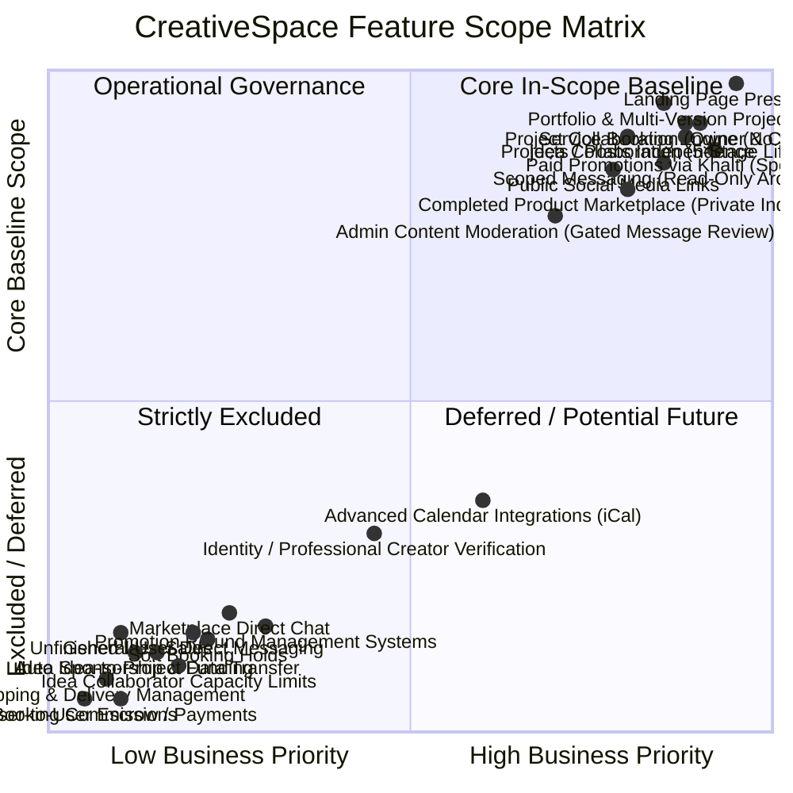

### 12.1 In Scope (Baseline Implementation Scope)
1. **Landing Page Preservation:** Complete preservation of the existing landing page aesthetic, design, layout, typography, and styling.
2. **User Authentication & Profiles:** Secure registration, email credential ownership verification, password recovery, creator profile management, and **unrestricted public social media links**.
3. **Creative Portfolio & Projects:** Project publishing supporting visual, audio, literary, photographic, and multimedia assets.
4. **Project Collaboration:** Structured Project Owner and Project Contributor roles, contributor draft viewing, version creation, asset uploading (without changing Owner-controlled Project visibility), active-Project attribution protection (`PROJ-001`, `PROJ-002`, `PROJ-003`), and Project Owner authority to remove or unpublish an individual contributor item with attribution and audit metadata (who removed it, when removed, and affected item) preserved (`DEC-020` Approved / `PROJ-004`), while contributor history after entire Project deletion remains OPEN (`DEC-021` / `OPEN-003`).
5. **Project Versions & Feedback:** Multi-version progression tracking with decoupled permissions (public feedback viewing, private draft media protection, owner/contributor editing rights).
6. **Creative Feed & Community Showcase:** Chronological/curated updates, progress announcements, and community commentary—fully independent from Projects.
7. **Explore Engine:** Multi-category discovery covering Creators, Projects, Feed Posts, Ideas, Services, and Completed Products, with clear "Sponsored" labeling for package-defined promoted items appropriate to their eligible content type (without guaranteed impressions, reach, ranking, engagement, or commercial conversion).
8. **Idea Collaboration (5-Stage Lifecycle):** Concept creation, role definition, independent dual-intake workflow (Creator Applications and Owner Invitations supported concurrently) across `Draft`, `Recruiting`, `In Progress`, `Completed`, and `Archived` statuses (Draft is private; Recruiting is publicly discoverable; public discoverability for In Progress, Completed, and Archived statuses remains subject to open decision DEC-018 / OPEN-002), with non-transferable seats, no platform capacity caps, exact messaging triggers, Idea Owner reopening authority back to `In Progress` with active messaging restored (DEC-015 Approved / IDEA-006), and `In Progress` to `Recruiting` transition preserving existing team roster and history (DEC-019 Approved / IDEA-007).
9. **Idea & Project Independence:** Completely separate workflows; manual project creation with zero automatic data or collaborator transfer.
10. **Creator Service Booking:** Service listings, client requests, multi-client slot competition handling without soft holds (`BOOK-001`–`003`), single 48-hour informational reminder (`BOOK-004`), manual creator release (`BOOK-005`), manual confirmation, and bidirectional 24-hour alternative-time negotiations (`DEC-017` Approved / `BOOK-006`, `BOOK-007`) with dual $S_1$/$S_2$ slot holds and immediate release of superseded alternatives (`BOOK-008`) preserving selection states on acceptance/decline/expiry (`BOOK-009`–`012`), while only the requester informational notice remains OPEN (`DEC-016` / `OPEN-001`).
11. **Completed Product Marketplace:** Product listings for finished goods only, private data-minimized buyer purchase inquiries (buyer/seller access only; buyer name from profile, inquiry message, account email collected only where necessary, optional external handle; no phone requirement), and direct external payment. External buyer-seller arrangements and fulfillment remain entirely the responsibility of the buyer and seller. CreativeSpace does not manage or prescribe delivery methods or workflows and does not provide shipping, digital-download, or fulfillment-tracking features.
12. **Scoped Contextual Messaging:** Communications strictly tied to active booking requests and accepted Idea collaboration teams. Completed conversations become read-only archives.
13. **Paid Platform Promotions:** Package-defined promotional visibility opportunities across eligible content types (Projects, Posts, Services, Products) via Khalti integration, with mandatory Sponsored disclosure and no guaranteed performance outcomes. Eligibility is restricted to authenticated content owners (privacy settings cannot be bypassed); platform promotion revenue records; dedicated promotion refund management features are excluded.
14. **Administration & Moderation:** Abuse reporting, content moderation, account management, strictly gated administrative inspection of reported messages with audit logging, and promotion transaction tracking.

### 12.2 Out of Scope (Explicitly Excluded Features)
1. **General Social Networking:**
   - General friend requests, follower approval barriers, or connection requests.
   - Connection-gated social media links.
   - General-purpose, unprompted direct messaging or open chat channels.
2. **Marketplace Messaging & Delivery Systems:**
   - On-platform marketplace chat or buyer-seller direct messaging channels.
   - Shipping integrations, tracking APIs, digital download delivery pipelines, delivery-status management, fulfillment workflow management, or delivery-dispute resolution.
3. **Automatic Idea-to-Project Data Transfer:**
   - Automated conversion workflows, automatic copying of Idea metadata/assets/history, or automated collaborator transfer.
4. **Platform Collaborator Capacity Limits:**
   - Platform-enforced collaborator capacity limits, target team-size requirements, or capacity warnings.
5. **Soft Booking Holds:**
   - System holds that block new clients from requesting a slot while another request is selected but unconfirmed. (This exclusion applies to client selection alone and does not contradict temporary concurrent dual slot holds during active alternative-time negotiation).
6. **Promotion Refund Management Features:**
   - Dedicated refund request interfaces, approval workflows, refund dashboards, automated refund processing, or credit management systems in current scope.
7. **User-to-User Financial Intermediation:**
   - The platform strictly excludes user-to-user financial intermediation. The exclusion of financial transaction recording refers specifically to external user-to-user financial transaction recording and must not prohibit legitimate platform operational records:
     - **Excluded:**
       - Processing external user-to-user payments.
       - Verifying external payment receipts.
       - Recording user-to-user financial transactions.
       - Escrow and wallet services.
       - User-to-user refund processing.
     - **Included (Legitimate Platform Operational Records):**
       - Booking request records.
       - Booking status and selection history.
       - Alternative-time negotiation records.
       - Marketplace purchase inquiry records.
       - Project collaboration history.
       - Idea application and invitation records.
       - Promotion payment records belonging to CreativeSpace itself.
8. **Idea Financing & Speculation:**
   - Idea sponsorship, crowdfunding, or trading unfinished Ideas.
9. **Alternative Platform Monetization:**
   - Subscriptions (Creator Pro), booking commissions, or listing fees.

### 12.3 Potential Future Enhancements & Deferred Considerations
*These items represent considerations that do not conflict with core boundaries but are deferred from the initial baseline:*
1. **Commercial Promotion Packaging Details:** Finalizing fixed pricing tiers in NPR, placement mappings, and duration packages with executive leadership prior to PRD specification.
2. **Marketplace Inquiry Retention Policy:** Defining a formal retention and archival duration for private purchase inquiries based on privacy and business requirements.
3. **Message Retention Automatic Purge Duration:** Defining an automated deletion duration for read-only historical message archives accounting for legal and moderation requirements.
4. **Third-Party Calendar Synchronization:** One-way synchronization (e.g., iCal feed export) of confirmed booking slots to external personal calendars (Google Calendar, Apple Calendar).
5. **Standardized Collaboration Agreement Templates:** Optional downloadable legal agreement templates for creators to formalize external compensation terms offline.
6. **Identity or Professional Creator Verification:** A formal creator verification or vetting badge system, if prioritized by business stakeholders in a future release.

---

## 13. Business Constraints and Assumptions

### 13.1 Business & Financial Constraints
- **C-FIN-001 (Sole Revenue Source):** The platform business model depends entirely on revenue generated from paid promotions. No operational assumptions may rely on transaction commissions, listing fees, or user subscription billings.
- **C-FIN-002 (Single Payment Gateway Dependency):** CreativeSpace relies on **Khalti** as its exclusive merchant payment gateway for promotions. Promotion revenue is subject to Khalti's API availability, service uptime, and domestic transaction policies.
- **C-FIN-003 (Commercial Operational Boundary & User Financial Independence):** CreativeSpace is not a party to user-to-user commercial agreements, service booking arrangements, Idea collaboration compensation, or completed product sales. The platform does not collect, process, verify, record, or escrow user-to-user funds, and users transact directly at their own discretion. Each participant independently conducts their transactions and remains responsible for applicable statutory, tax, and contractual obligations arising from their direct arrangements under relevant law. Separately, the platform's exclusion of dedicated software refund features for its own Khalti promotions represents a product release boundary and does not constitute a waiver of statutory consumer rights, mandatory payment provider rules, or legal obligations.

### 13.2 Regulatory & Legal Constraints
- **C-LEG-001 (Applicable Legal & Content Moderation Framework):** CreativeSpace operates under applicable laws, including relevant legislation of Nepal (such as the Electronic Transactions Act, 2063, Copyright Act, 2059, and Consumer Protection Act, 2075) as well as relevant international standards where applicable. This document references statutory frameworks for operational context but does not present a definitive legal interpretation of their applicability or consequences. Formal qualified legal review is required for content moderation obligations, copyright reporting and takedown procedures, Terms of Service liability disclaimers, safe-harbor eligibility, platform liability boundaries, and applicable regulatory requirements.
- **C-LEG-002 (CreativeSpace Statutory Independence & Regulatory Neutrality):** CreativeSpace's operational non-intermediation in user-to-user transactions does not imply that the platform is exempt from its own corporate, operational, statutory, tax, invoicing, or regulatory responsibilities, including those arising from its platform promotion revenue. CreativeSpace's own statutory, tax, invoicing, and regulatory responsibilities remain distinct, must not be assumed, and must be assessed independently with qualified legal and tax advice. This document does not constitute formal legal or tax counsel, nor does it establish definitive legal conclusions regarding platform licensing, invoicing, or tax reporting requirements.

### 13.3 Operational Constraints
- **C-OPS-001 (Manual Booking Confirmation Dependency):** The accuracy of creator availability calendars relies on creators manually confirming bookings upon receiving external payments. Platform workflows must account for creators who delay or neglect manual confirmations, supported by a single 48-hour informational reminder.
- **C-OPS-002 (Strict 24-Hour Negotiation Timers):** Alternative-time negotiation rules operate on a strict 24-hour clock. System automation must reliably enforce timeout expirations and slot releases without manual administrative intervention.

### 13.4 Business & User Assumptions
- **A-001:** Creators value direct earnings retention and are willing to coordinate external payments and deliveries directly with clients and buyers.
- **A-002:** The presence of public social media links will drive genuine external discovery and trust without compromising on-platform booking and portfolio usage.
- **A-003:** Creators will recognize the marketing value of package-defined promotional visibility opportunities to justify recurring promotion purchases via Khalti.
- **A-004:** Clients and Idea collaborators will accept scoped, context-bound messaging strictly for accepted Idea collaboration and booking discussions (with no Project messaging channel) rather than demanding open social networking.

---

## 14. Business Risks and Mitigation Strategies

| Risk ID | Risk Category | Risk Description | Business Impact | Mitigation Strategy |
| :--- | :--- | :--- | :--- | :--- |
| **RSK-001** | Payment / Dispute | A client claims they paid the creator externally, but the creator refuses to confirm the booking or deliver the service. | User frustration, platform reputation damage, dispute friction. | **Clear Platform Terms & Informational Notices:** Terms of service and interface notices clearly establish that CreativeSpace does not intermediate, track, or verify external payments, and does not adjudicate payment disputes. While scoped messaging preserves communication history for user reference, it does not prove external payment, does not verify payment receipt, does not establish a platform-recognized financial transaction, and does not create a platform dispute-resolution process. Users with credible fraud concerns may submit general abuse reports under BR-MOD-001 for administrative review. |
| **RSK-002** | Marketplace / Fulfillment | A marketplace seller takes external payment from a buyer but fails to ship the physical product or transmit digital files. | Buyer dissatisfaction, loss of marketplace trust. | **Peer-to-Peer Commercial Disclaimers & General Fraud Moderation:** The buyer and seller independently arrange and complete any physical or digital product fulfillment outside CreativeSpace. CreativeSpace does not manage, prescribe, track, enforce, or administer fulfillment methods or workflows, nor does it resolve delivery disputes. Separately, the platform provides reporting tools under general community moderation rules (BR-MOD-001) to flag fraudulent listings or conduct. Administrative actions, including content removal, account restrictions, or further sanctions where appropriate, shall follow the approved moderation policy, applicable Terms of Service, and legal review. This moderation process is strictly for platform safety and account governance, not a delivery-dispute or fulfillment-management service. |
| **RSK-003** | Operational / Booking | A creator selects a client for a slot but leaves the request unconfirmed for an extended period. | Competing clients are left waiting; booking calendar becomes stale. | **Informational Reminders & Open Inbound:** Selection does not block new requests; system sends a single informational reminder to the creator after 48 hours; creator can manually release selection back to pending at any time. |
| **RSK-004** | Commercial / Monetization | Creators decline to purchase paid promotions, causing platform revenue to fall below operational sustainability targets. | Platform budget deficits, operational strain. | **Package-Defined Promotional Visibility Opportunities:** Promoted content receives package-defined promotional placement opportunities appropriate to its eligible content type, with mandatory "Sponsored" disclosure and no guaranteed reach, impressions, ranking, engagement, or commercial conversion outcomes. Packaging options, duration tiers, and pricing structures remain subject to commercial configuration and executive sign-off prior to PRD approval. |
| **RSK-005** | Legal / Copyright | Users upload copyrighted artwork, plagiarized design assets, or unauthorized intellectual property to portfolios or marketplaces. | Legal liability, statutory infringement claims, community backlash. | **Notice-and-Takedown Protocol:** Dedicated reporting categories for copyright infringement adhering to the Nepal Copyright Act, 2059, and relevant international frameworks. Administrative actions, including content removal, account restrictions, or further sanctions where appropriate, shall follow the approved moderation policy and applicable legal requirements. |
| **RSK-006** | Platform Safety & Privacy | Malicious users utilize scoped messaging channels to harass collaborators or attempt off-platform scams. | User harassment, safety compromise. | **Contextual Reporting (Active & Read-Only Archives) & Strictly Gated Admin Inspection:** Users can report harassing messages in both active and terminal read-only archived conversations without reopening the conversation or restoring messaging. Administrator inspection remains strictly gated to formal abuse reports or documented ToS investigations by authorized personnel accessing minimum necessary content with mandatory audit logging (see `BR-MOD-003`). |
| **RSK-007** | Technical / External API | Khalti gateway experiences downtime or API service interruptions during promotion checkout. | Inability to purchase promotions, immediate revenue loss. | **Resilient Platform Transaction Handling:** Implement idempotent transaction callbacks, clear user retry messaging, and automated reconciliation logging strictly for creator-to-platform Khalti promotion transactions. (Khalti integration is strictly platform-only and never applies to service booking payments or marketplace product transactions). |

---

## 15. Key Performance Indicators (KPIs) and Success Criteria

*Governance Note on Operational Definition:* The metrics defined below establish the evaluative criteria for platform growth, collaboration efficiency, and commercial viability. To maintain analytical integrity, no metric is treated as implementation-ready where core business parameters remain undecided. For every KPI, elements requiring operational sign-off prior to measurement—including numerators, denominators, measurement periods, eligibility/exclusion criteria, reporting sources, and formal calculation formulas—are explicitly labeled as pending operational definition.

### 15.1 Platform Growth & Community Health KPIs

1. **Active Registered Creators**
   - **Business Objective:** Measure the volume of authenticated creators actively engaging with platform capabilities rather than holding dormant accounts.
   - **Preliminary Metric Description:** Count of registered creators demonstrating qualifying activity within a defined reporting period across any core platform module (publishing/updating Projects, publishing Feed Posts, managing Ideas, offering Services, or listing Products).
   - **Operational Definition Status (Pending Sign-off):**
     - *Numerator / Count:* Count of unique authenticated creator IDs with at least one qualifying action.
     - *Denominator:* N/A (absolute volume) or total registered creators (activity rate).
     - *Measurement Period:* Pending operational sign-off (e.g., rolling 30-day window, calendar month).
     - *Eligibility Criteria:* Definition of which specific creator actions qualify as "active" engagement.
     - *Exclusion Criteria:* Banned, suspended, or unverified accounts; automated administrative actions.
     - *Reporting Source:* Platform activity event logs and database action audit timestamps.
     - *Formula:* Pending executive approval of qualifying activity weightings and thresholds.

2. **Showcase Portfolio Velocity**
   - **Business Objective:** Assess creator content creation frequency and the iterative depth of portfolio development across creative disciplines.
   - **Preliminary Metric Description:** Aggregate count of new Creative Projects and successive iterative Project Versions published across supported disciplines within a reporting period.
   - **Operational Definition Status (Pending Sign-off):**
     - *Numerator / Count:* Total count of newly published Project entities plus total count of newly published iterative Versions.
     - *Denominator:* N/A (raw velocity) or average versions per active project.
     - *Measurement Period:* Monthly / quarterly cadence.
     - *Eligibility Criteria:* Publicly published versions and draft versions shared with project contributors.
     - *Exclusion Criteria:* Deleted draft placeholders, unpublished empty projects, test versions.
     - *Reporting Source:* Project and Project Version database creation records.
     - *Formula:* Disaggregated into: (a) New Projects Published, and (b) Iterative Versions Published per project cohort.

3. **Feedback Engagement Density**
   - **Business Objective:** Gauge the vibrancy and constructive quality of peer-to-peer critique on published creative works.
   - **Preliminary Metric Description:** Ratio of published project versions that receive qualified constructive feedback from the community within a defined timeframe.
   - **Operational Definition Status (Pending Sign-off):**
     - *Numerator:* Count of eligible published project versions receiving at least one qualified feedback comment.
     - *Denominator:* Total count of publicly published project versions within the measurement period.
     - *Measurement Period:* Pending operational sign-off (e.g., 30 days post-version publication).
     - *Eligibility Criteria:* Publicly viewable project versions eligible for community critique.
     - *Exclusion Criteria:* Private draft versions; self-comments by the version author; comments flagged or moderated as spam, abusive, or non-constructive. (Qualitative guidelines for what constitutes "constructive feedback" require operational definition).
     - *Reporting Source:* Version feedback comment database tables and moderation audit logs.
     - *Formula:* Feedback Density = (Eligible Versions with Qualified Feedback / Total Public Eligible Versions) * 100% (Formula and threshold pending operational approval).

4. **Explore Engagement Rate**
   - **Business Objective:** Evaluate the effectiveness of the central Explore engine in driving discovery and connecting visitors/users to creative content.
   - **Preliminary Metric Description:** Frequency and depth of user interactions within the Explore module, including keyword searches, disciplinary category filtering, and subsequent content/profile click-throughs.
   - **Operational Definition Status (Pending Sign-off):**
     - *Numerator:* Total count of successful discovery click-throughs (navigating to a Creator Profile, Project, Post, Idea, Service, or Product from Explore).
     - *Denominator:* Total unique Explore browsing sessions or total search/filter queries initiated.
     - *Measurement Period:* Daily / weekly / monthly reporting intervals.
     - *Eligibility Criteria:* Interactions originating strictly within Explore search bars, filter pills, and grid displays.
     - *Exclusion Criteria:* Direct external URL navigation, web-crawler/bot sessions, unauthenticated bounce sessions.
     - *Reporting Source:* Web analytics session tracking and client-side interaction event logs.
     - *Formula:* Click-through rate per search session; pending operational definition of session timeout boundaries.

### 15.2 Collaboration & Booking Velocity KPIs

5. **Idea Collaboration Velocity**
   - **Business Objective:** Track community ideation momentum, progression across the 5 lifecycle stages, and successful team assembly rates.
   - **Preliminary Metric Description:** Total volume of collaborative Ideas initiated, distribution across the five lifecycle statuses (`Draft`, `Recruiting`, `In Progress`, `Completed`, `Archived`), and volume of collaborator seats filled via accepted applications and invitations.
   - **Operational Definition Status (Pending Sign-off):**
     - *Numerator:* Count of Ideas advancing to `In Progress` and `Completed` statuses; count of accepted collaborator roster additions.
     - *Denominator:* Total Ideas created or total recruitment openings initiated.
     - *Measurement Period:* Monthly cohort analysis.
     - *Eligibility Criteria:* Legitimate Idea entities with defined roles and active recruitment.
     - *Exclusion Criteria:* Ideas abandoned in `Draft` status without advancement; ideas archived within 24 hours of creation.
     - *Reporting Source:* Idea entity records, application records, and invitation status logs.
     - *Formula:* Progression rate from `Recruiting` to `In Progress` and application acceptance rate; pending operational approval.

6. **Project Collaboration Engagement**
   - **Business Objective:** Measure the depth and prevalence of multi-contributor collaborative partnerships on formal portfolio projects.
   - **Preliminary Metric Description:** Proportion of active Creative Projects featuring accepted Project Contributors, and the volume of version contributions authored by contributors vs. project owners.
   - **Operational Definition Status (Pending Sign-off):**
     - *Numerator:* Count of Creative Projects with at least one accepted Project Contributor; count of versions uploaded by contributors.
     - *Denominator:* Total active Creative Projects published within the cohort.
     - *Measurement Period:* Quarterly collaboration assessment.
     - *Eligibility Criteria:* Projects with active non-owner contributor memberships.
     - *Exclusion Criteria:* Solo projects; projects where invitations were dispatched but unaccepted.
     - *Reporting Source:* Project membership association records and version author audit logs.
     - *Formula:* Pending operational definition of active contributor thresholds.

7. **Booking Request Fulfillment**
   - **Business Objective:** Measure the efficiency and fulfillment rate of creator service booking requests while preserving creator commercial autonomy.
   - **Preliminary Metric Description:** Percentage of initiated service booking requests that successfully achieve manual creator confirmation, accounting for requests legitimately pending creator response.
   - **Operational Definition Status (Pending Sign-off):**
     - *Numerator:* Total count of booking requests reaching `CONFIRMED` status via manual creator confirmation.
     - *Denominator:* Total eligible booking requests resolved within the measurement window. (The operational definition must specify whether the denominator includes all initiated requests or only concluded requests).
     - *Measurement Period:* Rolling 30-day / 60-day window.
     - *Eligibility Criteria:* Authenticated client booking requests submitted for valid creator availability slots.
     - *Exclusion Criteria:* **Active pending requests still within acceptable creator response windows must NOT be classified as failed fulfillment.** The formula must clearly disaggregate: (a) Client-withdrawn requests, (b) Creator-declined requests, (c) Competing requests automatically closed upon slot confirmation, and (d) Active pending requests.
     - *Reporting Source:* Service booking state machine transaction records.
     - *Formula:* Fulfillment Rate = (Confirmed Bookings / Approved Operational Denominator) * 100% (Exact denominator definition—distinguishing creator confirmations, client-withdrawn requests, creator-declined requests, competing requests closed after slot confirmation, and active still-pending requests—remains pending operational sign-off; active pending requests are never counted as failed fulfillment).

8. **Negotiation Resolution Metrics**
   - **Business Objective:** Evaluate the effectiveness of the alternative-time negotiation framework in resolving scheduling conflicts and protecting booking pipelines.
   - **Preliminary Metric Description:** Disaggregated tracking of all initiated alternative-time proposals across their three mutually exclusive outcomes, plus timeout analysis.
   - **Operational Definition Status (Pending Sign-off):**
     - *Numerator / Disaggregated Counts:*
       1. *Accepted Proposals (Outcome A):* Count of proposals accepted by receiving party (client or creator under `DEC-017`), updating booking to S2 and releasing S1.
       2. *Declined Proposals (Outcome B):* Count of proposals declined by receiving party (client or creator), releasing S2 and restoring S1.
       3. *Expired Proposals (Outcome C):* Count of proposals lapsing past the 24-hour response window, releasing S2 and restoring S1.
       4. *Counter-Proposal Volume:* Frequency of bidirectional counter-proposals / modified times resetting the 24-hour timer and releasing superseded alternative slots.
     - *Denominator:* Pending operational sign-off (e.g., total concluded vs. total initiated alternative-time proposals).
     - *Measurement Period:* Monthly analysis (pending sign-off).
     - *Eligibility Criteria:* Formal alternative-time proposals submitted under `BR-BOOK-005` (`BOOK-006` through `BOOK-012`).
     - *Exclusion Criteria:* Proposals where the parent booking was manually cancelled prior to proposal conclusion.
     - *Crucial Rule:* **Proposal expiry (Outcome C) must NEVER be counted as a successful resolution or acceptance.** Acceptance, Decline, and Expiry must remain strictly distinguishable.
     - *Reporting Source:* Booking negotiation audit logs and slot hold timestamps.
     - *Formula:* Disaggregated outcome rates pending operational sign-off on exact denominators and target thresholds.

### 15.3 Commercial & Marketplace Success Indicators

9. **Marketplace Catalog Depth**
   - **Business Objective:** Track the scale, variety, and health of completed creative product offerings available for community discovery.
   - **Preliminary Metric Description:** Point-in-time count of currently active, published, eligible completed creative product listings across physical and digital creative disciplines.
   - **Operational Definition Status (Pending Sign-off):**
     - *Numerator / Count:* Point-in-time count of unique published eligible product listing IDs currently in `ACTIVE` catalog status.
     - *Denominator:* N/A (point-in-time catalog volume) or disaggregated by category.
     - *Measurement Period:* Point-in-time snapshot cadence pending operational sign-off.
     - *Eligibility Criteria:* Published listings for completed creative products adhering to `BR-MKT-001` currently marked `ACTIVE`.
     - *Exclusion Criteria:* Inactive listings (toggled inactive under `BR-MKT-003`); listings unpublished or removed for moderation violations. **Repeated Active/Inactive toggles or moderation unpublishing events must never artificially inflate, double-count, or distort the point-in-time count.**
     - *Reporting Source:* Marketplace product catalog point-in-time state snapshot.
     - *Formula & Thresholds:* Point-in-time count of unique `ACTIVE`, published, non-moderated eligible listings; target thresholds pending operational sign-off.

10. **Paid Promotion Purchase Volume**
    - **Business Objective:** Measure creator adoption of the platform's exclusive monetization feature across the four eligible content types.
    - **Preliminary Metric Description:** Total count of promotion packages purchased and successfully settled via Khalti within a reporting period.
    - **Operational Definition Status (Pending Sign-off):**
     - *Numerator / Count:* Total count of successful Khalti promotion payment callback confirmations.
     - *Denominator:* N/A (raw transaction volume) or disaggregated by content type (Projects, Posts, Services, Products) and duration package.
     - *Measurement Period:* Weekly, monthly, and annual financial reporting periods.
     - *Eligibility Criteria:* Transactions verified via idempotent Khalti payment callbacks and active promotion record creation.
     - *Exclusion Criteria:* Abandoned Khalti checkout sessions, failed transactions, and any reversed/refunded transactions recorded operationally under applicable legal or payment-provider obligations (dedicated promotion refund-management software features remain outside current release scope under `BR-PROM-005` / `FIN-006`).
     - *Reporting Source:* Platform promotion operational transaction ledger and Khalti merchant transaction records.
     - *Formula:* Sum of completed promotion package units (pending finance/operational sign-off on adjustment rules).

11. **Platform Promotion Revenue (Khalti Authorization, Settlement & Net Receipts)**
    - **Business Objective:** Track CreativeSpace's commercial sustainability from its sole approved revenue stream while maintaining strict accounting separation across transaction stages.
    - **Preliminary Metric Description:** Financial amounts generated strictly from creator paid promotions via Khalti, explicitly distinguishing payment authorization, successful payment confirmation, merchant settlement, payment-provider fees, and net settled receipts.
    - **Operational Definition Status (Pending Sign-off):**
     - *Distinct Tracked Components (Not Conflated):*
       1. *Payment Authorizations:* Initiated/authorized Khalti payment amounts (not treated as settled cash).
       2. *Successful Payment Confirmations:* Verified Khalti callback payments for activated promotions.
       3. *Merchant Settlements:* Funds settled by Khalti to CreativeSpace's merchant account.
       4. *Payment-Provider Fees:* Gateway transaction fees deducted per Khalti merchant terms.
       5. *Net Settled Receipts:* Net settled funds remaining after provider fees and any mandatory legal/provider adjustments.
     - *Measurement Period:* Pending finance and operational sign-off (e.g., daily reconciliation, monthly accounting close).
     - *Eligibility Criteria:* Verified Khalti platform promotion transactions.
     - *Exclusion Criteria:* **Strictly excludes all external user-to-user transactions, service booking payments, Idea collaboration compensation, and marketplace product sales.** Dedicated refund software features remain excluded (`BR-PROM-005`).
     - *Reporting Source:* Official Khalti merchant settlement statements cross-referenced with CreativeSpace promotion payment records.
     - *Formula:* Final accounting recognition and net revenue formula explicitly **pending finance and operational sign-off** without assuming unapproved fee structures or refund workflows.

12. **Promotion Renewal and Retention Rate**
    - **Business Objective:** Evaluate creator satisfaction and perceived return on investment (ROI) from paid promotional visibility.
    - **Preliminary Metric Description:** Percentage of promotion-purchasing creators who purchase two or more promotion packages within a specified operational measurement window.
    - **Operational Definition Status (Pending Sign-off):**
     - *Numerator:* Count of unique creator accounts purchasing at least two promotion packages within the defined measurement window.
     - *Denominator:* Total unique creator accounts purchasing at least one promotion package during the baseline period.
     - *Measurement Period:* Pending operational sign-off (e.g., 60-day, 90-day, or 180-day repeat purchase window).
     - *Eligibility Criteria:* Authenticated creators with at least one initial settled promotion purchase.
     - *Exclusion Criteria:* Creator accounts suspended or deleted between purchases; introductory or trial package configurations (unless approved commercially).
     - *Reporting Source:* Promotion customer transaction history logs.
     - *Formula:* Repeat Rate = (Creators with >= 2 Purchases / Total Promotion Customers in Cohort) * 100% (No speculative numeric targets or retention thresholds are assumed prior to operational baseline sign-off).

---

## 16. Inter-Module Dependencies

```mermaid
flowchart TD
    subgraph PublicBrowsing["Public Browsing Tier (No Auth Required)"]
        Landing["8.1 Landing Page Preservation"]
        Explore["8.6 Explore Engine"]
        PublicProfiles["Public Creator Profiles & Always-Public Social Links (No Connection Gating)"]
        PublicProjects["Public Projects & Versions (Owner-Controlled Project/Draft Visibility)"]
        PublicFeed["Public Feed Posts"]
        PublicIdeas["Public Ideas (Recruiting Status Public - In Progress, Completed, and Archived Discoverability Pending DEC-018)"]
        PublicServices["Public Creator Services"]
        PublicMarketplace["Public Marketplace Catalog"]
    end

    subgraph AuthenticatedManagement["Authenticated Management Tier (Auth Required)"]
        AuthProfiles["8.2 Authentication and Profiles"]
        ProjectsMgmt["8.3 Project Management and Collaboration"]
        ProjVersions["8.4 Project Versions & Iterative Feedback"]
        FeedMgmt["8.5 Post Management"]
        IdeasMgmt["8.7 Idea Collaboration"]
        BookingMgmt["8.9 Service Booking"]
        MarketplaceMgmt["8.10 Product Marketplace"]
        ScopedMsg["8.11 Scoped Messaging"]
        Promotion["8.12 Khalti Promotions"]
        Admin["8.13 Admin Governance"]
    end

    Landing --> PublicProfiles
    Landing --> Explore
    Explore --> PublicProjects
    Explore --> PublicFeed
    Explore --> PublicIdeas
    Explore --> PublicServices
    Explore --> PublicMarketplace

    AuthProfiles --> ProjectsMgmt
    AuthProfiles --> FeedMgmt
    AuthProfiles --> IdeasMgmt
    AuthProfiles --> BookingMgmt
    AuthProfiles --> MarketplaceMgmt
    AuthProfiles --> Promotion

    ProjectsMgmt --> ProjVersions
    ProjectsMgmt --> PublicProjects
    ProjVersions --> PublicProjects
    FeedMgmt --> PublicFeed
    IdeasMgmt --> PublicIdeas
    BookingMgmt --> PublicServices
    MarketplaceMgmt --> PublicMarketplace

    IdeasMgmt -->|Accepted Collaborators Only| ScopedMsg
    BookingMgmt -->|Active Booking Context Only| ScopedMsg

    ProjectsMgmt -.->|Eligible Owned Project| Promotion
    FeedMgmt -.->|Eligible Owned Post| Promotion
    BookingMgmt -.->|Eligible Owned Service| Promotion
    MarketplaceMgmt -.->|Eligible Owned Product| Promotion

    Promotion -->|Package-Defined Placement (Sponsored Label)| Explore
    Promotion -.->|Where Package Applicable (Sponsored Label)| PublicFeed

    Admin -->|"Account & Profile Abuse Governance"| AuthProfiles
    Admin -->|"Project & Asset Moderation"| ProjectsMgmt
    Admin -->|"Version & Feedback Moderation"| ProjVersions
    Admin -->|"Post & Comment Moderation"| FeedMgmt
    Admin -->|"Idea Moderation"| IdeasMgmt
    Admin -->|"Service & Booking Abuse Governance"| BookingMgmt
    Admin -->|"Listing & Inquiry Abuse Governance"| MarketplaceMgmt
    Admin -->|"Promotion Eligibility & Ledger Oversight"| Promotion
    Admin -.->|"Gated Inspection Only (Formal Report / ToS Investigation + Audit Log)"| ScopedMsg
```

1. **Public Browsing Independence & Visibility Restrictions:** Public visitors can access and explore the landing page, public creator profiles (with external social links **always publicly visible** without connection or follow gating under `BR-AUTH-003` / `CONTENT-002`), publicly published projects and versions, community feed posts, public Ideas (specifically `Recruiting` status; `Draft` status is strictly private; `In Progress`, `Completed`, and `Archived` visibility remains OPEN under `DEC-018`), public creator service listings, and completed product listings without requiring authentication. Private/draft Projects and inactive Marketplace listings remain non-public (`BR-PROJ-002`, `BR-MKT-003`), while creator external social links cannot be hidden behind connection barriers.
   - *Admin Governance Boundary:* Module `8.13` interfaces with Projects (`8.3`), Versions/Feedback (`8.4`), Posts (`8.5`), Ideas (`8.7`), Bookings (`8.9`), Marketplace (`8.10`), Profiles (`8.2`), and Promotions (`8.12`) strictly for content/account abuse governance, while message inspection (`8.11`) remains strictly gated to formal abuse reports or documented Terms of Service investigations with mandatory audit logging (`MSG-005`, `BR-MOD-003`).
2. **Authenticated Creation & Management Dependencies:** Creating, publishing, editing, or actively participating in platform workflows (publishing Projects, collaborating on Projects, posting to Feed, managing Ideas, submitting booking requests, submitting purchase inquiries, using scoped messaging, and purchasing Khalti promotions) strictly depends on an authenticated registered account.
3. **Idea and Project Independence:** Ideas and Projects are separate workflows. A Project created based on an Idea is manually created with zero automatic dependency or data coupling.
4. **Scoped Messaging Context Dependency:** Messaging channels cannot exist independently; they must instantiate strictly from an active booking request ID or an approved Idea ID (with accepted collaborators only). Terminal states transition to read-only archives.
5. **Promotion Injection Dependency:** Paid promotions depend on the existence of valid target entities across four eligible content types (an active Project, Post, Service, or Product) owned by the purchasing authenticated creator, compliance with visibility/moderation rules, and successful Khalti transaction settlement. Promoted content receives package-defined promotional placement opportunities appropriate to its eligible content type, with a clear Sponsored label appearing wherever the content is displayed as promoted (without guaranteed reach, impressions, ranking, engagement, or commercial conversion outcomes).

---

## 17. Finalized Stakeholder Decisions and Open Decision Register

This section records the final disposition of all proposed policies, distinguishing approved requirements, rejected proposals, and deferred matters:

| Decision ID | Decision Title | Stakeholder Disposition | Finalized Business Rule & Scope Implication |
| :--- | :--- | :--- | :--- |
| **DEC-001** | Alternative-Time Negotiation Outcomes & Dual Slot Holds | **APPROVED / KEPT WITH FINALIZED RULES** | Retained & Harmonized with `DEC-017` (`BOOK-006`, `BOOK-007`, `BOOK-008`). Bidirectional 24h response window applying to whichever party (creator or client) receives the latest proposal or counter-proposal, resetting upon each counter-proposal or modified time. Dual slot holds: only original slot S1 and currently active proposed slot S2 remain held during active negotiation (superseded alternative slots are released immediately upon replacement) to prevent conflicting commitments while allowing inbound requests into pending queues. Outcome A (Accept): updates slot to S2, releases S1, preserves prior selection state. Outcome B (Decline) and Outcome C (Expire): negotiation ends, S2 released, S1 restored, prior selection state preserved. Main booking is not cancelled. |
| **DEC-002** | Selected Booking Hold, Single Reminder & Manual Release | **APPROVED / KEPT WITH REFINEMENT** | Retained. Creator selects one client. Selected booking remains selected until creator confirms or manually releases. No automated cancellation. Single informational reminder sent to creator after 48 hours if unconfirmed (does not cancel or alter booking; not recurring). Manual release returns request to pending without cancellation. Competing requests remain pending until confirmed. |
| **DEC-003** | Idea-to-Project Data Transfer | **REJECTED / DO NOT KEEP** | Automatic Idea-to-Project data transfer or conversion is strictly excluded. Ideas and Projects are independent workflows. Creating a Project from an Idea is a manual action. Zero automatic data transfer (no title, description, category, assets, history, applications, or collaborators transferred). |
| **DEC-004** | Idea Collaborator Capacity Limits | **REJECTED / DO NOT KEEP** | Excluded. No global collaborator capacity limits, target team-size requirements, capacity-based application restrictions, or capacity warnings. Idea owners manage intake independently. |
| **DEC-005** | Product Listing Inactivity Policy | **DEFERRED** | Supported basic active/inactive toggle. Automated 90-day inactivity prompts deferred from initial baseline scope. |
| **DEC-006** | Promotion Packages, Placements & Tiers | **APPROVED / KEPT (Commercial Details Deferred)** | Retained. Promoted content receives package-defined promotional placement opportunities appropriate to its eligible content type (Projects, Posts, Services, Products) via Khalti, with a clear "Sponsored" label appearing wherever the content is displayed as promoted. Eligibility strictly follows content visibility, publication, and moderation rules; privacy cannot be bypassed; only authenticated content owner can purchase. No guaranteed impressions, reach, ranking, engagement, or commercial conversion outcomes apply. Khalti is used exclusively for creator-to-platform promotion payments. Dedicated refund-management software features remain excluded from current scope. Specific duration packages, placement mappings, and fixed NPR pricing represent commercial configurations to be approved prior to PRD. |
| **DEC-007** | Promotion Refund Management | **REJECTED / OUT OF CURRENT SCOPE** | Dedicated promotion refund-management software features (refund interfaces, approval workflows, automated processing, credits, dashboards) are strictly excluded from current release scope. Khalti promotions are operational transactions. This product boundary does not constitute a waiver of statutory consumer protection obligations or mandatory payment provider requirements, which are managed operationally. |
| **DEC-008** | Future Creator Verification System | **DEFERRED** | Formal creator identity or professional verification badges are excluded from initial baseline; deferred to potential future post-baseline releases. |
| **DEC-009** | Project Collaboration Roles & Permissions | **APPROVED / KEPT WITH DEFINED ROLES** | Retained. Two distinct roles: Project Owner (primary project management, manages contributors, project metadata, visibility, archiving, and overall project deletion; `PROJ-001`, `PROJ-005`) and Project Contributor (views permitted drafts, uploads assets, creates new versions). Contributors cannot edit project info, change visibility, invite/remove contributors, or modify/delete other contributors' work (`PROJ-002`). During the active Project lifecycle, attribution and history must be preserved (`PROJ-003`), and removing a contributor does not automatically remove their contributions. Memberships are non-transferable. Under `DEC-020` (Approved / `PROJ-004`), the Project Owner may remove or unpublish an individual contributor version/asset from the active Project view while preserving attribution and audit metadata (who removed it, when removed, and affected item), distinct from permanent historical erasure. Treatment of contributor attribution and history after entire Project deletion remains OPEN (`DEC-021` / `OPEN-003`). |
| **DEC-010** | Idea Operational Lifecycle Statuses | **APPROVED / KEPT WITH 5 STAGES** | Retained (`IDEA-005`). Five standardized statuses: `Draft`, `Recruiting`, `In Progress`, `Completed`, and `Archived`. Only the Idea Owner changes lifecycle status; collaborators joining does not automatically change lifecycle status; no automated completion; archived ideas not auto-deleted. Completed and Archived statuses render collaboration messaging read-only. Under `DEC-015` (Approved), Owner can reopen Completed/Archived to `In Progress`; under `DEC-019` (Approved), Owner can transition `In Progress` back to `Recruiting`. Public visibility tiers for `In Progress`, `Completed`, and `Archived` remain open under `DEC-018`. |
| **DEC-011** | Soft Booking Hold | **REJECTED / DO NOT KEEP** | Excluded. Selection of a client does NOT block new inbound booking requests. New clients can submit requests for that slot while another request is selected but unconfirmed. Existing competing requests remain pending. Creator can manually release selection back to pending. |
| **DEC-012** | Marketplace Inquiry Privacy & Data Minimization | **APPROVED / KEPT WITH REFINED RULES** | Retained. Inquiries strictly private to buyer and seller. Minimal data collected: buyer name from profile, inquiry message, account email (only where necessary), and an optional external contact handle. No phone number required. Proposed 90-day automatic deletion rule rejected; retention duration deferred to future policy. |
| **DEC-013** | Scoped Message Retention & Gated Admin Inspection | **APPROVED / KEPT READ-ONLY (Deletion Deferred)** | Retained. Terminal booking and Idea conversations transition to read-only archives. Participants can view and can still report previously received abusive messages (reporting does not reopen the conversation, restore messaging, or alter terminal status); participants cannot send new messages. No user message deletion in initial release. Proposed 180-day automatic deletion rule deferred. Gated admin inspection strictly limited to formal user abuse reports or documented Terms of Service investigations by authorized personnel accessing minimum necessary content with mandatory audit logging. |
| **DEC-014** | Collaborator Seat Transferability Policy | **APPROVED / KEPT (Strictly Non-Transferable)** | Retained. Collaborator seats in Ideas and contributor memberships in Projects are personal and strictly non-transferable. Replacing a member is a brand-new invitation. Active-Project attribution and history must be preserved (`PROJ-003`), while post-entire-Project-deletion treatment remains OPEN under `DEC-021`. |
| **DEC-015** (IDEA-006) | Idea Lifecycle Reopening Policy | **APPROVED / KEPT WITH FINALIZED RULES** | Approved. The Idea Owner has the authority to reopen a Completed or Archived Idea back to `In Progress`. Upon reopening: (a) Accepted collaborators retain their membership and active collaboration messaging access; (b) Existing applications, invitations, messages, and collaboration history are preserved; (c) Rejected applicants and rejected invitees are not automatically reactivated; (d) No Project is automatically created; (e) The Idea Owner may subsequently transition the reopened Idea from `In Progress` to `Recruiting` if additional collaborators are needed. |
| **DEC-016** (OPEN-001) | Competing Inbound Queue Notice During Negotiation Holds | **OPEN / STAKEHOLDER DECISION REQUIRED** | The core queuing and dual-hold behavior is approved: both S1 and S2 are held during active negotiation; new inbound requests for S1 or S2 enter the creator's queue as pending requests and cannot override active holds or be confirmed in conflict with them. The unresolved stakeholder decision is whether a new requester attempting to book S1 or S2 during an active negotiation hold should receive an explicit informational notice disclosing that the slot is temporarily held during another negotiation, or whether requests submit into the pending queue with standard pending status without active hold disclosure. |
| **DEC-017** (BOOK-006, BOOK-007) | Bidirectional Alternative-Time Negotiation & Timer Resets | **APPROVED / KEPT WITH FINALIZED RULES** | Approved. Alternative-time negotiation is bidirectional: either the creator or the client can propose an alternative calendar date/time or submit counter-proposals during booking scheduling. The strict 24-hour response window applies to whichever party receives the proposal/counter-proposal. Any new counter-proposal or modified time submission resets the 24-hour response timer while maintaining dual slot holds on S1 and S2. Acceptance updates slot to S2 and releases S1; decline or expiration releases S2 and restores S1; parent booking remains intact on S1 with prior selection status preserved across all outcomes. |
| **DEC-018** (OPEN-002) | Public Discovery and Visibility Rules by Idea Operational Status | **OPEN / STAKEHOLDER DECISION REQUIRED** | Confirmed rules: `Draft` Ideas are strictly private to the Idea Owner; `Recruiting` Ideas are publicly discoverable without authentication to visitors and users on Explore. The unresolved stakeholder decision is the exact public visibility rules for Ideas in the remaining three lifecycle statuses (`In Progress`, `Completed`, `Archived`) across three potential visibility tiers: Tier 1 (publicly visible to unauthenticated visitors), Tier 2 (visible only to registered/authenticated users), and Tier 3 (strictly private to Idea Owner and accepted collaborators). Internal collaboration messages, private contact details, and restricted assets remain strictly private regardless of Idea visibility. |
| **DEC-019** (IDEA-007) | Operational Lifecycle Status Transitions (In Progress to Recruiting) | **APPROVED / KEPT WITH FINALIZED RULES** | Approved. The Idea Owner has the authority to transition an Idea from `In Progress` back to `Recruiting` to seek additional collaborators (e.g., if a collaborator leaves or new skill sets are required). Existing accepted collaborators retain their team roster seats and collaboration messaging access; collaboration history and chat logs are preserved; and public applications and direct owner invitations are reopened. |
| **DEC-020** (PROJ-004) | Project Owner Authority to Remove Individual Contributor Versions or Assets | **APPROVED / KEPT WITH FINALIZED RULES** | Approved. The Project Owner has the authority to remove or unpublish an individual version or creative asset contributed by a Project Contributor from the active Project view. When an Owner removes a contributor version or asset: (a) The version or asset is removed/unpublished from the active Project view; (b) Attribution for the removed work is strictly preserved in historical/audit logs (recording who created it, upload timestamp, version ID, and who removed it and when); (c) The removal does not delete or alter other versions or assets in the Project; (d) The removed contributor does not lose attribution for work they contributed. Contributors cannot remove or delete versions or assets contributed by other contributors, and removing a contributor does not automatically remove their contributions. Removal from the active Project must be distinguished from permanent historical erasure or purge; audit logging is mandatory. |
| **DEC-021** (OPEN-003) | Contributor Attribution and Historical Records Retention Upon Entire Project Deletion | **OPEN / STAKEHOLDER DECISION REQUIRED** | The Project Owner has confirmed authority to delete an entire Project entity subject to confirmation safeguards (PROJ-005 Approved). The unresolved stakeholder decision is what happens to contributor attribution, contribution history, and related records when an entire Project entity is deleted by the Project Owner: specifically, whether contributor versions and portfolio links persist in an archived contributor portfolio view (e.g., 'Collaborated Project - Deleted by Owner') or are completely purged from public views while retaining private audit logs. |
---

## 18. Comprehensive Glossary

| Term | Formal Business Definition |
| :--- | :--- |
| **Creator** | An authenticated registered user who publishes creative work, provides creative services, organizes collaborative Ideas, collaborates on Projects, or lists completed creative products. |
| **Visitor** | An unauthenticated public individual accessing CreativeSpace to browse public portfolios, feed posts, explore listings, creator profiles, and the landing page. |
| **Client** | A registered user who initiates a structured service booking request with a creator. |
| **Buyer** | A registered user who discovers, inquires about, and arranges the external purchase of a completed creative product from a creator. |
| **Creative Project** | A structured portfolio showcase representing an individual or collaborative creative work across visual, audio, literary, photographic, or digital disciplines. Independent from Feed Posts. |
| **Creative Post** | A standalone community showcase post published to the Creative Feed. Independent from Creative Projects. |
| **Project Version** | A specific sequential stage or release state within a project (e.g., draft sketch, revision 2, final master), maintaining decoupled permissions between file editing (no auto-publishing of Project visibility by contributors) and public feedback, while preserving contributor attribution and history during the active Project lifecycle (`PROJ-003`). Under `DEC-020` (Approved / `PROJ-004`), the Project Owner may remove or unpublish an individual contributor version/asset from the active Project view with attribution and mandatory audit metadata (who removed it, when removed, and affected item) preserved (distinct from permanent historical erasure). Treatment of contributor attribution and history after entire Project deletion remains strictly OPEN under `DEC-021` (`OPEN-003`). |
| **Project Owner** | The creator who creates and holds primary ownership of a Creative Project, retaining sole authority to configure Project-level visibility, manage contributors, edit Project metadata, archive, and delete the Project entity (`PROJ-001`, `PROJ-005`). Under `DEC-020` (Approved / `PROJ-004`), may remove or unpublish individual contributor-uploaded versions or assets from the active Project view while preserving attribution and mandatory audit metadata (who removed it, when removed, and affected item), distinct from permanent historical erasure. Treatment of contributor attribution and history after entire Project deletion remains strictly OPEN under `DEC-021` (`OPEN-003`). |
| **Project Contributor** | An authenticated creator explicitly invited by a Project Owner who has accepted project collaboration, granting them permissions to view permitted drafts, upload assets, and create new versions without permission to overwrite or delete another contributor's work. Memberships are personal and non-transferable. |
| **Feedback** | Constructive textual commentary and critique submitted by authenticated users on publicly viewable project versions. Viewable by everyone. Public feedback does not automatically expose private draft media files. |
| **Idea** | An early-stage creative concept or production opportunity published by an Idea Owner to assemble a team of collaborators across a 5-stage lifecycle. Independent from Projects. |
| **Idea Owner** | The creator who initiates, authors, and manages an Idea, retaining full authority over candidate review, team recruitment, and lifecycle status changes. |
| **Idea Statuses** | The five approved operational lifecycle stages of an Idea: `Draft`, `Recruiting`, `In Progress`, `Completed`, and `Archived`. `Draft` is confirmed private to the owner; `Recruiting` is confirmed publicly discoverable without authentication. Under DEC-015 (Approved / IDEA-006), the Idea Owner can reopen Completed or Archived Ideas back to `In Progress` with active collaboration messaging restored. Under DEC-019 (Approved / IDEA-007), the Idea Owner can transition an Idea from `In Progress` back to `Recruiting` with existing team roster and history preserved. The public discoverability and visibility tier of `In Progress`, `Completed`, and `Archived` Ideas across unauthenticated visitors vs. registered users remains an open stakeholder decision under DEC-018 (OPEN-002). |
| **Applicant** | A creator who independently discovers an Idea and submits a formal application. Applicants do not receive messaging access while pending. |
| **Invitee** | A creator who receives a direct formal invitation from an Idea Owner. Invitees do not receive messaging access while pending. |
| **Collaborator** | A creator whose application has been accepted by the Idea Owner, or an invitee who has accepted the owner's invitation, granting them access to the Idea roster and Idea-scoped messaging. Membership is non-transferable. |
| **Creator Service** | A professional creative capability offered by a creator on the platform with defined scopes, turnaround times, and pricing guidance. |
| **Booking** | A structured scheduling agreement between a client and creator for the provision of a creator service. |
| **Alternative-Time Proposal** | A proposed alternative calendar slot submitted during booking scheduling, governed by simultaneous dual slot holds on original slot $S_1$ and currently active proposed slot $S_2$ (with superseded alternative slots released immediately upon counter-proposal replacement; `BOOK-008`), a strict 24-hour response window for the latest recipient, and a timer reset upon counter-proposals or modified times. Under `DEC-017` (Approved / `BOOK-006`, `BOOK-007`), negotiation is bidirectional (either creator or client may propose and counter-propose). All three negotiation outcomes preserve prior selection state without cancelling the parent booking (`BOOK-009`–`011`). Only whether new requesters receive an informational hold notice remains OPEN under `DEC-016` (`OPEN-001`). |
| **Negotiation Status** | The operational state of an alternative-time proposal (`Pending`, `Accepted`, `Declined`, `Expired`), maintained strictly distinct from the primary booking status (`Requested`, `Selected`, `Confirmed`, `Declined`, `Cancelled`). |
| **Dual Slot Holds** | The temporary concurrency control where both the original requested slot (S1) and the currently active proposed alternative slot (S2) are held simultaneously during active alternative-time negotiation to prevent conflicting commitments, while allowing new inbound requests to enter pending queues without overriding the holds. Historical proposals that have been superseded release their alternative slot holds immediately (`BOOK-008`). |
| **Completed Creative Product** | A finalized digital or physical creative asset listed for direct sale in the Marketplace. Unfinished Ideas, speculative concepts, and prototypes cannot be listed as products. Creator listing availability toggling (active/inactive) is an independent catalog management control, not a delivery status, shipment status, or fulfillment workflow. |
| **Purchase Inquiry** | A structured, private on-platform record submitted by an authenticated buyer expressing interest in a completed product, capturing buyer name from profile, inquiry message, account email (only where necessary), and an optional external contact handle. A phone number is not required. Visible strictly to the submitting buyer and listing seller. Does not include on-platform chat, order management, or delivery tracking. |
| **Paid Promotion** | A paid visibility enhancement purchased by an authenticated content owner via Khalti across eligible Projects, Posts, Services, or Products, providing package-defined promotional placement opportunities appropriate to its eligible content type with a mandatory clear "Sponsored" label appearing wherever the content is displayed as promoted. Does not provide guaranteed impressions, reach, ranking, engagement, or commercial conversion outcomes. |
| **Sponsored Label** | A mandatory visual disclosure displayed on promoted content wherever it appears across platform discovery surfaces to ensure advertising transparency. |
| **Discovery & Operational Enablement Model** | The operational doctrine under which CreativeSpace facilitates creative discovery, collaboration, service booking, and marketplace structure while completely excluding itself from user-to-user payments, escrow, and product fulfillment. |
| **Scoped Messaging** | Direct messaging channels strictly restricted to active booking request contexts and accepted Idea collaboration teams (Project collaboration is not a messaging context). Terminal conversations become read-only archives; read-only status does not prevent participants from reporting previously received abusive messages (without reopening the conversation or restoring messaging). General direct messaging and marketplace chat are prohibited. |
| **Khalti Gateway** | The third-party digital payment provider integrated exclusively for processing creator payments to CreativeSpace for paid platform promotions. |
| **Landing Page Preservation** | The governing architectural mandate that the existing public landing page's visual design, layout, typography, colors, and overall aesthetic must be preserved intact. |

---
*End of CreativeSpace BRD — Baseline Version 2.0 — Working Draft — Pending Final Stakeholder Approval*
